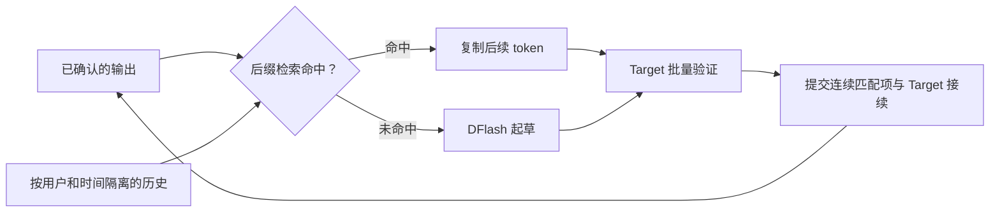

# MemoryDraft

**从历史文本起草，用目标模型验证。**

MemoryDraft 是一个单 GPU 大模型推理项目。它用历史片段或 DFlash 提供候选 token，由同一个目标模型严格验证，再通过 HTTP/SSE 输出已确认的结果。项目提供可安装的运行时、可复现的评测，以及跨会话历史在什么负载下有用的实验记录。

[快速运行](#快速运行) · [架构与运维](docs/INFRA_GUIDE.md) · [实测报告](docs/RUNTIME_MIGRATION_RESULTS.md) · [研究索引](https://github.com/2223434778/MemoryDraft/blob/codex/branch-drift/docs/RESEARCH_INDEX.md) · [冻结演示版 v0.3](https://github.com/2223434778/MemoryDraft/tree/infra-v0.3-interview)

## 它怎么工作



**严格解码。** R 命中时可以跳过一次 Draft 前向。Target 只接受从首位开始连续匹配的草稿 token，首次分歧处用自己的预测接续。连续复用后切回 DFlash 时，使用已确认的 Target 特征补齐 Draft KV。

**服务与评测。** CLI 和 FastAPI 共用推理引擎。HTTP 接收并发请求，由有界队列交给一个 GPU worker。支持 SSE、超时、断连取消与背压，并提供 AR 逐 token 对照、性能回归、HTTP 压测和 CPU/CUDA profiler。

## 实测结果

同一张 RTX A6000，Qwen3-8B + DFlash b16，FP32/eager，greedy。下表为 **8 个受控多轮 JSON 配置修订请求**在新运行时各重复三次的总推理时间。

| 方法 | 总推理耗时 | 输出 |
| --- | ---: | --- |
| DFlash，同一适配器关闭历史复用 | 42.06 s | 与 AR 逐 token 一致 |
| **R+DFlash** | **33.88 s（降低 19.4%）** | 与 AR 逐 token 一致 |

另一批两个短请求的工程验收中，R+DFlash 慢了 10.6%，因为格式差异导致复用候选大多被拒绝。离线归因还发现，展开当前请求已有事实即可覆盖正例中的绝大部分复用机会。19.4% 的结论限于上述负载和引擎计时。 [迁移实测](docs/RUNTIME_MIGRATION_RESULTS.md) · [短请求验收](docs/INFRA_VALIDATION.md) · [收益归因](docs/REUSE_ATTRIBUTION_RESULTS.md)

## 快速运行

在仓库根目录的 Python 3.11 虚拟环境中执行。CPU demo 使用合成引擎，无需权重。

```bash
python -m pip install -e ".[serve,client]"
python -m memorydraft infer --config configs/runtime-demo.json --request examples/request.json --method AR --output artifacts/demo-answer.json
python -m memorydraft serve --config configs/runtime-demo.json --port 8000
```

启动后可在 [本机 API 文档](http://127.0.0.1:8000/docs) 查看接口。真实推理环境、固定模型版本和 GPU 验收命令见 [Infra 使用指南](docs/INFRA_GUIDE.md)。当前交付范围是单 GPU、batch=1、greedy 和 FP32/eager。

## 从哪里继续读

| 想了解 | 入口 |
| --- | --- |
| 总体设计与源码入口 | [快速交接](https://github.com/2223434778/MemoryDraft/blob/codex/branch-drift/docs/MEMORYDRAFT_HANDOFF.md) |
| R/H/D 研究、OT 对照、早期 ASD 与缓存实验 | [研究索引](https://github.com/2223434778/MemoryDraft/blob/codex/branch-drift/docs/RESEARCH_INDEX.md) |
| 安装、API、性能指标与故障排查 | [Infra 使用指南](docs/INFRA_GUIDE.md) |
| 复现报告与原始快照 | [面试版归档与复现](https://github.com/2223434778/MemoryDraft/blob/codex/branch-drift/docs/INFRA_INTERVIEW.md) |
| 独立的树流项目 | [ShuLiu-Decode](https://github.com/2223434778/ShuLiu-Decode) · [分仓说明](https://github.com/2223434778/MemoryDraft/blob/codex/branch-drift/docs/PROJECT_SPLIT.md) |

第三方代码保留各自的许可与固定来源。模型权重、私有历史、数据库和大型性能 trace 不随仓库分发。
