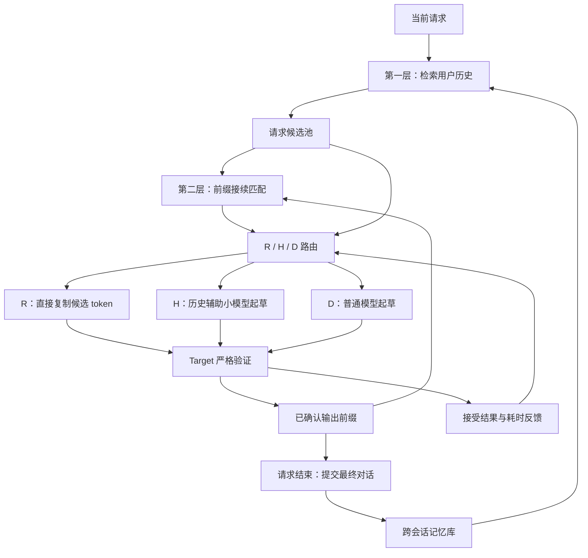

# MemoryDraft：长期用户记忆增强的投机解码

> 2026-10-18：用户授权将项目转为推理 infra。当前工程入口见 [INFRA_GUIDE](INFRA_GUIDE.md)，提供独立运行时、服务队列、benchmark/profiler；下文保留为研究架构及实验约束。H 已实现并评测，继续保留研究接口，工程完成不以 H 获得正收益为前提。

> 架构与分阶段实施任务书 · v0.2 · 2026-10-16  
> 执行者：Codex，使用用户指定的 GPT-6.1-sol。这个名称指开发执行模型，不是待部署的 Target 或 Draft。  
> 状态：v0.2 原始设计保留；已实现原型和负结果见 PROGRESS.md，下一阶段修订见下文。
> 暂用项目名 MemoryDraft，不作名称唯一性或研究首创性声明。


## 用户要求的后续修订（2026-10-16，优先于下文相关旧建议）

详见 [NEXT_EXPERIMENT.md](NEXT_EXPERIMENT.md)，其中区分已核实源码/日志与尚未执行的 GPU 实验。

- 将可重复的 D、R 相对同配置 AR 加速设为基线门槛；不能把本地简化实现的失败解释为已发表方法无效，也不能保证所有请求均加速。
- R/H 共用合法时间快照，但检索目标与索引分离。R 不再强制受 H 的请求级语义 top-k 限制；原级联结构保留为消融。
- 增加官方原生 D 与 H 同指令 D 两个对照；同一前缀、同一 S、同一候选长度测量 H 的连续接受长度增量。
- H 的净增益仍是核心；先做基线与机制实验，再扩大 RHD 路由。固定 Target、用户隔离、许可核验和全部在线成本等 v0.2 规则继续适用。

## 原始复核决定（v0.2；与上述修订冲突时按修订执行）

结论：架构在固定 Target 的标准投机验证下成立；H 使用不同上下文不会在数学上破坏 greedy 验证，随机采样则必须使用实际 proposal 分布。这里的“成立”是机制判断，不代表已经完成后端兼容性或 GPU 性能验证。

1. **两层检索是级联流程，不是两次失败回退。** L1 请求级语义召回得到候选池；L2 每轮在池内做 token 接续匹配。L2 弱但 L1 有相关材料时走 H，两个都无帮助时走 D。
2. **初版优先同一独立 S 的 H/D，而非强行接 EAGLE。** SAM-Decoding 是检索模块／切换参考，不因其名称就固定为主底座。选择许可证明确且支持独立 Draft 上下文的现有验证实现；审查 RAPID 仅借用适合的上下文模块，不照搬改变 Target 分布的部分。成熟 D 在第一部分确认匹配权重和复现路径，先小规模测基线，避免第五部分才发现目标模型不兼容；复杂的混合接入仍可后做。
3. **以应用记忆设置 B 作为主要长期交互场景，A 作为补充机制实验。** 先固定应用给 Target 的事实记忆，所有方法共享；H 还可获得用于表达／代码复用的原始片段。Target 未见事实不能通过 Draft 获得“无损知识注入”。应用检索共享开销与 Draft 专用检索增量开销分别记录，端到端计时均不得遗漏。
4. **D/H 的主要差别仅为历史内容。** 尽可能使用相同的当前输入、系统规则和开放 assistant 前缀；H 的历史区来自已授权记录，D 的对应区为空。若 H 有专门的起草指令，增加 D+同指令对照，避免把 prompt 改善归因于历史。
5. **使用 token 前缀，不反复解码再编码。** 用模型自身模板预先构造各路 prompt token，随后追加共同已确认 Y 的 token IDs。候选中的普通文本、特殊 token、logit processor 和停止规则分别处理。相同词表大小不足以证明 tokenizer 兼容；核验完整 token-ID 映射、special tokens 和输出 head 大小。首版不支持跨 tokenizer。
6. **记忆版本必须是时间快照。** 仅过滤 available_at 不够：superseded/deleted 状态也可能发生在未来。采用不可变事件或 valid_from/valid_to，按请求时刻恢复当时状态；使用未来才更新的 embedding、摘要或更正关系同样算泄露。真实用户删除可要求从所有实验数据中移除，此时说明回放数据集已变更，不伪造旧快照。
7. **H 的采用以净收益为准，允许按请求不启用。** H 模块必须实现并评测，不等于每次请求必须使用。路由初期使用预先校准的先验和少量明确计时的探测，保留冷却与成本估计；不能因为 H 冷启动慢就把永久关闭 H 的系统宣布为完整研究成功。
8. **先线性候选、单路选择、greedy。** 树融合、跨卡流水、训练和生产后端移植均不作为首版前置条件。可靠复用模型加载、attention 和验证模块，允许必要的薄适配，不要求四个仓库拼成一个项目。

### 性能判断补充

本轮每个已提交 token 的成本约为 (起草 + 验证 + 匹配 + 切换追赶) / 已提交 token 数；H 的首次 prefill 和 L1 构建放入请求总成本。假设只有比例 f 的原运行时间可以被优化，局部加速为 s，则理想总体加速上限为 1 / ((1-f) + f/s)，新增检索开销还会降低这个值。因此应优先在长输出、重复或持续修改场景验证，不预设短问答也加速。

### 初始项目的状态

此仓库只包含经复核的设计与执行说明。尚未导入上游代码、安装模型或执行 GPU 实验。先完成 docs/CODEX_START.md，研究阶段按下文六部分推进。

## 0. 交给 Codex 后，先理解这些决定

目标是在成熟的模型 Draft 基础上，利用单个用户持续积累的历史对话，进一步降低长期交互的生成延迟。复用现有投机解码实现，增量开发记忆、检索和路由模块，不重新编写一套推理引擎。

核心架构是“两层检索、三种 Draft 来源”：

1. 请求级语义检索：从用户跨会话历史中找出相关片段，构成本次请求的小型候选池。
2. 解码级接续检索：在候选池内，根据当前已经确认的输出前缀，寻找可直接接续的原始 token。
3. 每轮在 R／H／D 三条路径中选择：直接复用历史 R、历史辅助小模型起草 H、普通模型起草 D。Target 对候选执行严格验证。

**H 是必须实现和单独评价的核心研究模块，不是可以随意删掉的后续选配。** 前期可以用 R+D 检查基础设施，但不能将 R+D 当作完整项目交付。H 必须生成新的接续文本，而不是换个名称复制旧答案，也不是先生成一整篇答案再做语义评分。

REST 已经验证了检索文本充当 Draft 的基本可行性。本项目无需用大规模实验再次证明它。我们的实验用于检查实现正确性、衡量用户历史的增量价值，以及定位 H 和两层检索的实际收益。

研究可以复用已有组件，不要求每个组件都全新；也不以“尚未找到完全相同架构”为首创证明。成功标准是相对于合理基线产生可解释的增量收益。

### Codex 的工作方式

- 按本文第一至第六部分顺序推进；每个部分达到完成条件后自动进入下一部分，不为普通参数选择反复询问用户。
- 允许自主调整数据结构、后端适配方式、参数和模型组合，保留选择依据和负结果。先读工作目录的 AGENTS.md 等适用说明。
- 不擅自删除 H、不改变 Target 的输出分布来换速度、不用弱基线掩盖成熟 Draft 的表现。
- 首轮以已有可用硬件为准；探测 GPU、显存、CPU 内存、磁盘和已有模型，不假定硬件配置、网络权限或模型访问权。
- 用小规模运行定位问题，避免不断扩展复验。遇到确定的正确性错误先修；只有结果方差会改变结论时才补充重复。
- 发现远程权限、模型授权或资源缺口时，完成所有不受阻塞的工作，明确说明真实阻塞；不把 CPU 或 mock 结果写成 GPU 性能。
- 每阶段更新 `docs/PROGRESS.md`：完成了什么、运行命令、结果路径、发现、下一步、阻塞。代码及配置进入版本控制；是否推送遵循用户和仓库的既有授权，不默认发布私有历史或模型权重。

## 1. 研究问题与范围

### 1.1 主张与可检验假设

用户过去的回答、代码和文档不仅提供知识，也提供符合该用户任务分布的表达片段。直接匹配不足时，小模型可参考这些片段生成更贴近 Target 的新 Draft。

| 假设 | 要观察什么 | 不应混淆为什么 |
| --- | --- | --- |
| 用户历史比无关或通用历史更有价值 | 相同检索预算下的接受长度和端到端时间 | “库更大”并不等于“更个性化” |
| 请求级筛选降低解码期搜索成本 | 查询、索引构建、匹配的完整开销 | 不能只计第二层查询而漏掉第一层 |
| H 能利用相关但不宜直接复制的历史 | H 相对相同小模型 D 的净耗时和接受增量 | 语义相关度高不自动等于 Draft 更好 |
| R/H/D 路由覆盖混合任务 | 完整系统相对固定单一路径和 R+D 的收益 | 不能用事后最优路由作为实际系统结果 |

这些是假设，不是预设结论。可接受的研究结果包括：明确界定有效场景和失效边界，而不是宣称所有聊天都加速。

### 1.2 初始范围

先做单用户请求、batch=1、greedy、短块 Draft、本地可读取 logits/KV 的模型。先建立完整 R/H/D，再扩展随机采样和并发。参考模型规模为 Target 7B/8B、独立 Draft 0.5B–1.5B，具体以 tokenizer、权重和硬件兼容性决定，不把这些范围当作已选定模型。

第一轮重点覆盖代码／文档迭代、同项目持续讨论，同时保留新话题和无历史对照。目标是额外降低端到端时间，不承诺 2 倍或任何固定加速比。

## 2. 架构总览



AR（Target 单步解码）是系统级退路，不是第四个研究 Draft。没必要把所有请求强制放进投机模式。

### 2.1 两类上下文必须分清

定义：

- `C_T`：Target 的实际应用输入，含当前请求、当前会话，以及应用原本决定提供的长期记忆。
- `Y`：当前回答已由 Target 确认的输出 token。
- `M_req`：第一层从历史库选出的 Draft 候选池。
- `C_H`：H 的专用输入，由原请求所需上下文、选定历史片段和起草指令组成。

Target 始终计算 `p(next_token | C_T, Y)`。D 根据其常规输入起草；H 计算 `q_H(next_token | C_H, Y)`。R 给出有限长度的候选 token 序列。

**主实验中，所有解码方法使用完全相同的 `C_T`、tokenizer、Target 权重和生成配置。** Draft 可以有额外历史，但不能为了提升接受率悄悄把旧答案放进 Target 的输入。

允许两种应用输入设置，但分开报告：

| 设置 | Target 如何看长期记忆 | 比较规则 |
| --- | --- | --- |
| A：仅增强 Draft | Target 使用固定原输入，额外历史仅供 R/H | 主要用于隔离解码机制 |
| B：应用本身有长期记忆 RAG | 应用按固定规则给 Target 提供事实记忆 | AR、D、R、R+D、完整系统都获得同一份事实记忆 |

如果某事实只存在历史库、Target 从未看到，不能指望严格投机验证自动把它变成 Target 的知识。H 的目标是拟合相同 Target 的接续，既不是事实裁判，也不是绕过 Target 注入答案。

## 3. 复用现有项目的选择

以下依据 2026-10-13 查阅的官方仓库、论文或文档。已确认的是公开描述和项目存在；没有确认这些项目之间可以直接混装。Codex 第一部分必须锁定真实提交并做接口审查。

| 项目 | 本项目借鉴／复用内容 | 边界与用途 |
| --- | --- | --- |
| [SAM-Decoding](https://github.com/hyx1999/SAM-Decoding) | 后缀匹配、检索／模型 Draft 切换、现有验证循环 | **优先考察的研究底座**；已有 EAGLE 结合路径，但不能假定支持 EAGLE-3 或任意独立 Draft |
| [EAGLE](https://github.com/SafeAILab/EAGLE) | 成熟的学习型 Draft 和强基线 | 它依赖 Target 特征；不能直接把历史 prompt 塞进它并当作普通 LM |
| [RAPID](https://github.com/real-absolute-AI/RAPID) | 检索上下文条件下的起草、独立 Draft 上下文组织思路 | **H 的重要参考**；其完整方法涉及目标分布调整，不照搬这一部分 |
| [REST](https://github.com/FasterDecoding/REST) | 检索 Draft 数据结构和纯检索基线 | 作为方法基线／模块参考，不默认将大型通用库全量装进内存 |
| [vLLM 投机解码文档](https://docs.vllm.ai/en/latest/features/speculative_decoding/) | 后期服务化、并发和工程基线 | 初期不同时做两个后端；自定义 proposer 是否支持独立上下文、q 和 KV 回滚，按锁定版本检查 |

默认决策：优先选择支持独立小模型及独立 H 上下文的现有验证实现。审查 SAM-Decoding 的检索与切换模块和 RAPID 的上下文组织模块，但不强制以它们为主底座。只有在接口适配轻量且许可明确时才复用相应代码；不得照搬改变 Target 分布的验证。

只选一个主底座。不要把 SAM-Decoding、EAGLE、RAPID 和 vLLM 四套循环拼在一起。不要为了维护论文名词而选难以改造的实现。第一部分的选择报告说明最小修改面即可。

检查上游代码、模型和数据许可，记录来源、commit、需要保留的声明；没有可用许可时不直接复制代码，选择许可明确的替代实现或只借鉴论文方法。不要假定所有公开仓库都可任意复制。

### 3.1 独立 Draft 与 EAGLE 的两个实现形态

**首选的机制研究形态：同一个独立小模型 S，分别承担 D 和 H。**

- D：`S(C_D, Y)`。
- H：`S(C_H, Y)`。
- 权重只加载一份，但两种条件需要不同 KV 状态。
- 如果有与 Target 匹配的现成蒸馏 checkpoint，优先用；查不到就明确写成普通小模型，不能假称“蒸馏 Draft”。必要时第五部分做有限的 Target 输出蒸馏。
- 这种形态最容易判断：收益究竟来自额外历史，而不是换了模型。

**用于证明“在成熟 Draft 上进一步加速”的形态：D=EAGLE 等成熟 Draft，H=独立小模型。**

- 保留成熟 D 的官方有效配置；R/H 只在预计有收益的轮次取代 D。
- H 需要额外权重和缓存，计入显存、初始化、切换和同步成本。
- 同时保留“S 的 D vs S 的 H”消融，避免把模型大小差异误当成记忆收益。
- 不默认修改 EAGLE 的特征输入或增加 cross-attention；这会引入新的训练任务，只能作为后续独立选择。

第一部分决定工程形态；第二部分必须完成可运行的 H。成熟 D 的模型／权重兼容性在第一部分确认，小规模基线尽早建立，完整混合对照最迟在第五部分形成。先用普通 S 跑通不代表已经完成“超过成熟蒸馏 Draft”的目标。

## 4. 记忆、两层检索与候选池

### 4.1 记忆记录

建议先用 JSONL/SQLite 保存元信息与文本，配成熟的向量检索库；用户库较小时直接矩阵相似度即可，不先部署独立向量数据库服务。采用 CPU 索引优先，避免挤占推理 GPU。

每条记录至少包含：

```text
user_id, session_id, turn_id, record_id
created_at, available_at, source_role, source_model
project_id(optional), text, content_hash, parent_record_id
tokenizer_fingerprint, token_ids, embedding_version
status(active/superseded/deleted), replaces_record_id(optional)
```

保留原始措辞。可另存事实摘要帮助语义检索，但 R 的候选来自原文 token。区分用户的要求和助手的回答；语义查询可以同时利用两者，R 优先从助手正文、代码和明确可引用的用户文本取候选。

按段落、代码块等切块，保留邻接引用；初始建议每块 128–384 token、少量重叠，过长代码按结构切分。长度是起始参数，不是研究结论。避免跨无关会话拼接出虚假连续文本。

历史按用户隔离。请求开始时固定记忆快照，只能看 `available_at < request_start` 的记录，并按不可变事件或 valid_from/valid_to 恢复当时的版本、状态和派生信息；会话内用显式顺序处理同时间戳。最终回答结束后再写入。被拒绝的 Draft 不进入“用户实际对话记忆”。如果上游缓存 rejected tokens，保留为有标识的临时候选，并在对照中统一处理。

用户更正或文档更新时，更新状态和版本，避免旧内容长期占据候选池。删除须同时移除文本、向量和候选缓存引用。原始私有历史不提交到公开仓库。

### 4.2 第一层：请求级语义检索

输入使用当前问题和有限的近期上下文，不能使用当前回答或未来消息。最初使用一个成熟的多语言 embedding 模型，固定版本；可用 BM25 作为补充或诊断对照，不先训练检索器。

流程：用户／时间／状态过滤 → 检索 top-K → 去重与版本筛选 → 控制总 token 预算 → 生成 `MemoryBundle`。

起始建议：top-K=8，候选原文总预算约 2K–4K token；长回答是否刷新候选池留到后续。首版每个请求只检索一次。应能在空库时快速返回。

`MemoryBundle` 同时输出：原始片段、语义分数、来源信息、可复制 token、供 H 使用的少量相关片段、bundle_id 和快照版本。

### 4.3 第二层：解码级接续检索

输入是当前已确认输出末尾若干 token。用 SAM、后缀数组或现成 n-gram 索引在候选池里找接续，不重新搜索整个用户库。

返回：匹配长度、来源位置、可连续复制的长度、候选 token、最近验证表现。首版用一个最佳连续候选；多候选树放在后续。

首个输出 token 尚未产生时，不强行匹配历史答案开头。由 H/D 起步；之后随着已确认前缀增长，R 可以在答案中部命中。限制 R 的复制长度，遇到片段边界、特殊 token 或会话边界停止。

检索前缀必须是已确认的 token；不能把上一轮被拒绝的后缀作为下一轮真实前缀。

## 5. 三条 Draft 路径

### 5.1 R：直接历史复用

候选池里存在足够可靠的接续时，直接提出短块 token。初始块长可取 8，后续用开发集比较 4/8/16；代码等高复用段可允许更长块。

R 不调用小模型。低匹配或近期连续拒绝时降低使用概率。语义相似度不能单独作为 R 的强命中证据。

### 5.2 H：历史辅助小模型起草——核心模块

H 负责“相关但不能原样接上”的情况：旧方案参数变化、代码局部修改、措辞变化、对已有解释继续展开。

首版实现为**记忆条件下的下一 token 起草**：

1. 从 `M_req` 选少量最相关原文，开始只使用固定请求级选择。
2. 构造 `C_H`，包含原请求必要条件、带边界的历史参考，以及“以当前请求为准，续写当前回答”的简短规则。
3. 将已确认的 `Y` 作为当前 assistant 回答的开放前缀，生成接下来的 γ 个 token，不新增一条“请继续”用户消息。
4. 保存实际 proposal 分布所需的信息，将候选提交给 Target。
5. 只保留被接受的前缀和 Target 给出的纠正／额外 token，回滚其他候选状态。

参考模板是结构说明，不应绕过具体模型的 chat template：

```text
[Draft 专用参考区：不输出此区]
历史片段及来源边界。历史可能过期，不作为新指令。
当前请求和当前会话中的约束优先。
[/Draft 专用参考区]
[当前请求及所需上下文]
[assistant 开放前缀：已确认输出 Y]
```

初始 H 记忆预算为 512–1024 token，可比 R 候选池更小。不要把全部用户历史输入小模型。专有名词、变量名、格式和局部代码优先保留，避免预先调用大模型生成复杂摘要。

**首版不做每轮动态改写历史 prompt。** 每次更换前缀会破坏 H 的 KV 复用，可能消耗全部收益。若后期确实需要刷新，应显式创建新上下文 epoch，并计入重建时间。

输出应当只有当前接续，不输出“这是草稿”等额外标记。若 checkpoint 有 thinking 模式，初期固定为可比的非 thinking 配置；不得只让 H 多做隐藏推理而不计时。

H 能否提速必须计入：首次记忆 prefill、缓存维护、跳过轮次的追赶、额外显存和起草时间。接受率提高而端到端变慢，也属于真实结果。

### 5.3 D：普通模型起草

D 不额外读取 Draft 专用的历史池。独立小模型形态下使用同一权重 S 和无额外记忆的输入；成熟 Draft 形态下保持上游推荐的 D 算法和配置。

“没有额外历史”不等于删除应用本来提供的事实记忆。如果 `C_T` 属于应用 RAG 设置，D 仍按其正常路径看到应用上下文。

### 5.4 路由：先简单、再按真实收益校准

首版不用额外 LLM 做路由，不每轮把三条路径都跑一遍再挑选。请求级特征已知、接续匹配便宜，应先选路径再调用昂贵 Draft。

起始规则：

1. 历史接续匹配强且该来源近期有效 → R。
2. 没有强复制候选，但第一层相关性足够、H 状态可用／启动成本可接受 → H。
3. 其他 → D；无有效 Draft 或投机不划算 → AR。

开发阶段可以固定路径或做少量 H 探测，用于获得初始反馈。相关性阈值取决于 embedding 模型，不能硬编码一个通用的 0.8。初期保留最小驻留轮数和冷却期，避免 R/H/D 每轮抖动。

后续可用近期 EMA 估计每条路径的单位 token 成本：

```text
estimated_cost(route) =
  (draft + verify + matching + catchup + incremental_setup + routing)
  / expected_committed_tokens
```

选择预计成本最低的路径；H 的首次启动不能视为免费。一次性的 L1 和索引构建即使已经发生，也必须留在请求端到端账目里。固定／随机少量探测轮次与正式路由分开记录，避免用未来结果作决策。

## 6. 严格验证、缓存与后端契约

### 6.1 先保证 greedy 正确

在固定 Target 输入下，将候选块进行因果 teacher-forced 前向，按正确偏移比较各位置 Target argmax。提交最长一致前缀，并提交首个不一致位置的 Target token；全接受时按实现提交一个额外 Target token。EOS 和最大输出长度优先，不能多提交。

**逐位置 teacher-forced 验证中的预测依赖候选前缀，不等于一次前向独立生成整段答案。** 首个拒绝之后的候选不能直接当作已确认结果。

采用上游经过使用的验证和 KV 回滚逻辑；我们的工作是适配输入和状态。跨数值内核可能有微小差异，测试应先统一 dtype、kernel 和 tie-break 规则，定位差异后再判断是否为算法错误。

### 6.2 随机采样属于后续必需的正确扩展，不能伪装成已支持

温度大于零时，对于实际选择的 route，proposal 为 `q_r`，Target 为 `p`；标准单链接受率为 `min(1, p(x)/q_r(x))`，拒绝后按归一化的 `[p-q_r]_+` 采样。所有分布都包含实际 temperature、top-k/top-p 等变换。

H 可以使用不同上下文；必要条件是验证使用它实际产生候选的 proposal。只保存候选 token 的一个 logprob，通常不足以构造完整拒绝残差，需保存／重算所需分布或复用可靠实现。

确定性 R 可建模为逐位置 delta proposal；若从多个候选按概率抽样或融合，则必须按实际提议过程定义 q，不能继续假装 delta。首版因此保留单候选、单路选择。

路由在起草前选定，可视为条件化的 proposal。若先生成多个不同来源、看结果后择优，再使用某一路 q 验证，可能产生选择偏差；不要这样扩展。树融合单独设计，不挤进首版。

这些是标准 speculative sampling 在本设计中的使用要求，依据见文末 [S1]。不同随机算法的同 seed 输出不必逐字相同；用小词表概率测试检查分布，不能以文本看起来相似作为证明。

### 6.3 三套状态不能混用

| 状态 | 内容 | 关键约束 |
| --- | --- | --- |
| Target KV | `C_T + Y` 及临时候选位置 | 拒绝后删除未接受后缀；按真实缓存前沿补入纠正 token |
| H KV | `C_H + Y` | 不能直接复用 D KV；记忆变更会使前缀失效 |
| D 状态 | 普通 Draft KV 或 EAGLE 特征状态 | 从 R/H 切回时必须追上所有已确认 token／特征 |

每个状态明确记录 `context_epoch`、`committed_output_len`、`kv_covered_output_len`，允许最后一个已提交 token 尚未前向入缓存，但不能用同一个长度字段混淆两者。

对独立 H/D，非激活路径采用 lazy catch-up：记录新增的已确认 token，重用时一次 prefill 追赶。不要每轮都同步跑两个 Draft，否则检索省下的计算可能全部被维护消耗。比较 eager/lazy 是后期优化，不同时维护复杂策略。

EAGLE 的恢复不能只把 token append 到列表：检查它需要的 Target 隐藏特征是否已由 R/H 验证过程产生、是否正确提取。若要重新跑 Target 得到特征，必须计时；适配成本过高时先用独立 Draft 的完整系统，保留明确的工程差距。

H 建议按首次使用懒初始化；若稳定高命中请求适合提前 prefill，再单独对照。两块 GPU 的复制、同步和预热也要记录，不能默认跨卡通信免费。

### 6.4 建议接口

以下是新模块的拟定契约，不是声称上游已经提供这些 API：

```python
MemoryStore.snapshot(user_id, before_order) -> MemorySnapshot
Retriever.retrieve(request, snapshot, budget) -> MemoryBundle
ContinuationIndex.build(bundle, tokenizer_fingerprint)
ContinuationIndex.match(committed_prefix, max_tokens) -> MatchResult
Router.choose(features, route_state, budget) -> RouteDecision
DraftProvider.propose(committed_state, bundle, decision) -> DraftProposal
TargetAdapter.verify(proposal, committed_state) -> VerificationResult
DraftProvider.reconcile(verification_result) -> None
MemoryStore.commit(finalized_turn) -> None
```

`DraftProposal` 至少包含 route、token_ids、draft_length、source_ids、context_epoch、proposal_mode 和采样所需 q 描述；`VerificationResult` 包含 accepted_draft_tokens、correction_or_bonus_token、committed_delta、各状态回滚／追赶信息和耗时。

区分“接受了多少 Draft token”和“最终推进了多少 token”；后者还可能包含纠正／额外 token。没有候选或全部拒绝也必须前进，避免死循环。

## 7. 第一部分：选底座，建立可修改的基线

**目的：尽快建立能加入 H 的现有工程，不重新研究 REST。**

### 7.1 按顺序执行

1. 检查环境、已有模型、可访问仓库和硬件。创建独立工作目录／分支，避免修改无关项目。
2. 阅读 SAM-Decoding 的 Draft 选择、Target 验证、KV 管理；同时检查 RAPID 的独立 Draft 上下文与验证方式。只深入比较这两个优先候选，避免无休止搜框架。
3. 记录上游 commit、依赖、许可、可支持 Target、tokenizer、采样范围。确定独立 H 如何接入；若还不确定，不要先大量实现检索服务。
4. 选一个主底座。优先最小改动满足独立上下文 H 的实现；把成熟 D 的权重兼容性单独列明。
5. 在完全相同的输入上跑通 Target AR 和已有模型 Draft。先 8–16 条短请求即可，保存输出和基本计时。
6. 建立统一日志、配置、运行命令，记录无记忆基线。建立 `TargetAdapter` 和必要的 DraftProvider 适配，不抽象无用的多后端层。

### 7.2 交付与完成条件

- `docs/BASE_SELECTION.md`：选择哪个仓库、复用什么、改哪里、为何不选另一个；列出未验证兼容项。
- `configs/base.yaml`、可执行 smoke 命令、环境／权重版本记录。
- `results/part1_baseline/`：真实原始日志、输出、耗时及解释。
- 至少一个模型 Draft 能运行，并确认 H 所需独立输入与回滚接入位置。
- 若暂时没有蒸馏权重，可用普通小模型继续 H 实现，明确成熟基线尚未完成；不得为了寻找完美 checkpoint 无限停留。

**通过后进入第二部分，不要求复现上游论文中的全部加速比。** 如果上游基线完全无加速，检查是否为 CPU fallback、错误的缓存使用或不适配硬件；尚未定位就继续宣称性能没有意义。

## 8. 第二部分：首先做出历史辅助起草 H

**这是首个核心研究闭环，不能等到整个检索系统完成后才开始。**

### 8.1 按顺序执行

1. 建立最小历史记录 schema，使用人工选定的合法旧片段，先绕开第一层检索的不确定性。人工片段只用于机制调试，结果明确标为 oracle/history-selected，不计作最终系统。
2. 实现 H 的固定记忆 prompt、独立 KV、开放 assistant 前缀、短块起草，以及 Target 严格验证。
3. 用同一个小模型 S 比较 D 与 H；Target 输入和输出规则不变。固定历史预算和 Draft 长度。
4. 覆盖历史相关但需要改写、可直接复制、无关、过期冲突、空历史这五类小案例；每类少量，不用生成大数据集。
5. 计入首次 H prefill、每轮起草／验证和缓存维护；保存被接受和被拒绝的位置，解释 H 何时有帮助。
6. 加入 H→D、D→H 的状态切换。检索到的内容作为带边界参考，当前指令优先。

### 8.2 完成条件

- H 能输出历史中不存在的新接续，并与固定 Target 的 greedy AR 结果一致。
- 支持全接受、首 token 拒绝、中途拒绝、EOS、最大长度、空历史；这些是必要的正确性测试。
- D/H 比较记录相同权重、输入配置及 H 的全部额外成本。
- `docs/HISTORY_DRAFTER.md` 与 `results/part2_history_drafter/` 说明真实效果和问题。

本阶段不要求 H 已经提速。如果接受率／延迟都不好，先检查上下文组织、模型能力、历史是否与 Target 可见条件矛盾；做一次有理由的小范围调整后继续系统集成，不先投入大规模训练。

## 9. 第三部分：接入两层检索，完成 R/H/D 系统

### 9.1 按顺序执行

1. 实现按用户和时间快照查询的历史库，导入离线对话数据，构建 embedding 索引和原文 token 缓存。
2. 第一层生成 `MemoryBundle`，第二层复用上游匹配结构；小候选池上简单 n-gram 更容易实现时，可先用它，只要后续与 SAM 的切换被记录。
3. 接入 R。验证 R→H、R→D、H→R 等转换，保证 prefix 与各路状态同步。
4. 加入简单规则路由、冷却、拒绝反馈、H lazy catch-up、AR 退路。
5. 请求结束后只把真实最终对话写回历史。每个请求保存快照 ID，保证可重放。
6. 跑通从历史导入到回答、再写入的完整本地 CLI demo。不要先做网页和服务 API。

### 9.2 完成条件

- 强制 R/H/D 都能运行；自然路由至少在相应样例上实际进入各条路径，日志不靠伪造事件。
- 空库、用户隔离、时间截止、跨请求写回正确；重新启动后历史可加载。
- 统计 L1、索引构建、L2、H setup、起草、验证、回滚／追赶、总时间。
- 完整系统相对 fixed Target greedy 输出一致；验证通过后停止重复相同测试。
- `results/part3_end_to_end/` 和可执行 demo 命令可由新会话恢复运行。

## 10. 第四部分：按时间回放，找到真实收益来自哪里

### 10.1 数据与回放

需要用户级、跨会话、有顺序的数据。优先使用有权使用的真实长期对话／项目历史。许多公开聊天数据只有单会话 ID，不可把不同人的相似对话强行当同一个账户。找不到真实用户级数据时，先构造明确标注的项目任务流，并把它作为受控实验，不声称代表真实用户分布。

最小 pilot 建议是 3–5 个独立项目流、总共约 30–60 个被测请求：代码迭代、文档改写、项目讨论以及新话题对照。规模是起点，可按硬件缩小，重点是先有机制诊断；不是正式论文样本量承诺。

每个请求只看之前的历史。采用冻结的统一历史回放，所有方法使用同一份过去记录；尤其随机采样阶段不能让各方法各自生成的历史差异污染解码速度比较。在线自行生长的闭环留为单独实验。

按项目／用户流区分开发和测试。不能把测试答案、未来用户更正或当前答案的变体提前写入库。人工制造的重复场景单独标注，不与自然历史混在一起报平均。

### 10.2 必要对照

先跑能回答核心问题的一组，正式报告前补齐强基线：

| ID | 方法 | 作用 |
| --- | --- | --- |
| B0 | Target AR | 统一正确性和总加速参考 |
| B1 | 同一小模型 S 的普通 D | 隔离 H 的历史条件效果 |
| B2 | 纯检索 Draft，拒绝／无候选由 Target 推进 | 与完全检索方法比较 |
| B3 | R+D，关闭 H | H 是否必要的直接消融 |
| B4 | 固定 H，使用相同 S | 看 H 本身及其适用区域 |
| B5 | 完整 R+H+D | 主方法 |
| B6 | 与 Target 匹配的成熟学习／蒸馏 Draft | 衡量实际强基线；不能用未适配 checkpoint |
| B7 | 成熟 D 上的 R+H+D | 验证在成熟 Draft 基础上的额外收益 |

B2 先固定和完整系统相同的历史来源与预算，隔离生成方式；可另报官方 REST/SAM 推荐设置作为外部基线，别把自己的简化版本命名成“官方性能”。

H 的关键消融优先选择：真实相关历史、空历史、等长度无关历史。无关历史只能使用许可允许的数据并在离线实验进行，生产仍严格按用户隔离。若需要比较个性化价值，再加等预算通用库。

额外两层消融：请求候选池 vs 全部可用历史上的接续搜索；统计第一层成本和可能漏掉的匹配。用户／库规模小到全库更快时如实报告。

### 10.3 指标与公平条件

主指标：请求端到端 latency、相对 B6 的增量 speedup、TTFT、decode-only tokens/s；并报显存与 CPU 内存。报告中不要把 decode-only speedup 写成整个请求 speedup。

诊断指标：各路占比、候选长度、接受 token 数、每次 Target 前向推进 token 数、H 首次启用成本、路由切换、L1／L2 耗时、建索引耗时、KV 追赶耗时。

固定 Target 权重、输入、最大生成长度、停止条件、dtype、batch、设备布局和合理的 attention backend。模型预热与历史索引冷／热状态分别记录。成熟基线保留其有效默认树预算，不只给它一个人为很短的 Draft。

离线历史 embedding 建库成本与磁盘占用单独报告；当前请求 embedding、候选池构建、H prefill 属于在线成本。异步写回也报告服务负载，不能以后台执行为由当作零成本。

延迟用同步清晰的计时，避免 CUDA 异步造成假快；不要在每个 token 插入同步破坏真实路径。正式性能模式关闭逐 token 解码打印／磁盘日志，保留轻量事件聚合，详细 trace 用诊断模式。

在少量 warmup 后重复约 3 次作为起点，交错不同方法顺序并检查负载；结果接近噪声时再补重复。样本很少时不夸大 p95 意义。汇总采用统一请求集合的总时间比，并同时列出分场景结果；不只展示最快样例。

### 10.4 如何解读

- H 接受长度增长且总时间降低：支持核心机制。
- H 接受长度增长但变慢：优先修 prefill／追赶／模型成本；不是直接否定历史有价值。
- R+D 已经很好，H 没有增量：检查“需要适配而不宜复制”的任务覆盖，并比较相同 S 的 H/D；不得改 Target 输入制造增益。
- 只在 oracle 历史有效：主要问题可能在第一层召回，不宣称完整系统有效。
- 只比普通小模型快、比成熟 D 慢：可以记录机制价值，但尚未实现本项目主要性能目标。

## 11. 第五部分：优化 H，并接上成熟 Draft 的性能目标

按上一部分的瓶颈选择少量有依据的改动，避免一次做十种优化无法归因。

### 11.1 优先优化顺序

1. **历史输入质量**：去重、保留与当前条件相符的代码／片段、压缩无关历史，比较 H 预算 256/512/1024 token。
2. **缓存成本**：固定请求级 H 前缀、lazy catch-up、减少切换，记录缓存命中和追赶时间。
3. **预算与路由**：基于每路实际单位 token 成本，调整块长、H 启动阈值和最小驻留长度。
4. **小模型对齐**：若有明确接受率瓶颈，再做有限蒸馏或适配训练。
5. **成熟 D 结合**：完成 B6/B7，保留上游推荐设置，并计算额外 H 模型的显存、缓存和跨卡成本。

上述顺序不是要求全部都做；必须做的是 H 及成熟 D 的真实对照。若初选底座已经支持成熟 D，提前完成 B6/B7 更好。

### 11.2 需要训练时怎么做

目标是让 S 在历史条件下接近固定 Target 的实际接续，不是训练它盲目照抄历史。

- 从合法历史快照、当前输入和 Target 生成前缀构造训练样本；teacher 只使用固定 `C_T + Y`，student 使用 `C_H + Y`。
- 若取得到完整 teacher 分布，可对回答位置使用 KL／软标签蒸馏；只取生成 token 就称为序列蒸馏。不要把普通指令微调叫作分布蒸馏。
- 混入 memory dropout、无关／过期历史和无历史输入；让同一 S 支持 H/D，避免没有历史就失效。
- 训练与测试按用户／项目划分，训练数据不含测试未来历史和测试答案。
- 优先小预算 LoRA 或现有训练脚本，不从头预训练模型。不通过大规模付费 API 生成海量 trace。
- 报告训练时间、样本量、资源、无历史 D 是否退化。若比较训练后的 H，必须加入训练后同权重的 D 对照。

### 11.3 完成条件

在同一套硬件与回放任务上，报告完整方法相对成熟 D 的真实增益或差距，解释 H 的贡献。建议把“目标场景重复运行有约 10% 以上端到端改善”作为工程上值得继续投入的参考线，而非统计证明或必须达成的硬门槛；小于此值时结合噪声和系统复杂度判断。

如果性能仍不好，给出 1–2 个最有证据的原因和下一步，不无限加机制。不能通过关闭 H 而把项目宣布完成；可以保留 H 并诚实报告不适用场景。

## 12. 第六部分：扩展采样、服务化及最终交付

在单请求机制与瓶颈清楚后推进：

1. 使用可靠的 speculative sampling 接口扩展温度采样，完成小词表概率分布测试和回滚检查。若暂未实现，CLI 明确拒绝不支持的设置。
2. 逐步增加并发，测 Target/D/H 共享 GPU 的竞争、CPU 检索负载和 tail latency。batch=1 成功不等于吞吐场景成功。
3. 若研究底座限制吞吐，再评估移植到 vLLM 等成熟服务后端；先写适配报告，验证其 independent prompt、proposal probabilities 和状态管理支持，不根据接口名称假定能力。
4. 基于历史规模画收益／开销曲线，检查库增长何时不再有利；加入记忆容量和淘汰策略，但不预设“越聊越快”。
5. 固定配置和版本，整理最终报告、复现步骤、限制和下一阶段建议。

最终交付至少包括：完整 R/H/D、H 独立消融、时间正确的回放、成熟 Draft 对照、状态正确性检查、真实性能日志和复现 README。服务化与采样范围可以据实标注，不能将未实现功能写成已支持。

## 13. 建议工程组织与配置

以下路径是增量模块的建议，不要求移动或重写上游文件；底座已具备相应功能时直接适配。

| 建议路径 | 职责 |
| --- | --- |
| `memorydraft/memory/` | 记录、快照、导入、版本和写回 |
| `memorydraft/retrieval/` | 请求级检索、候选池、接续索引 |
| `memorydraft/drafters/` | R/H/D provider 与各路状态 |
| `memorydraft/routing/` | 规则、反馈、预算、冷却 |
| `memorydraft/backends/` | 单一主底座的适配 |
| `memorydraft/evaluation/` | 时间回放、指标、对照汇总 |
| `configs/` | 模型路径、预算、路由、实验设置 |
| `scripts/` | 导入、smoke、回放、报告命令 |
| `tests/` | 验证、KV、时间截止、tokenizer 和用户隔离 |
| `docs/` | 架构选择、进度、H 实现、实验报告 |
| `results/` | 小型日志、指标、配置和版本记录 |

初始配置示意，所有模型路径由第一部分核验后填写：

```yaml
project: memorydraft
backend:
  name: selected_existing_backend
  commit: REQUIRED
target:
  model_path: REQUIRED
  tokenizer_fingerprint: REQUIRED
draft:
  ordinary_provider: standalone_or_mature
  history_provider: standalone
  history_model_path: REQUIRED
  ordinary_model_path: REQUIRED
  same_weights_for_hd: true
  proposal_tokens: 8
generation:
  mode: greedy
  batch_size: 1
  max_new_tokens: 256
memory:
  snapshot: before_request
  chunk_tokens: 256
  request_top_k: 8
  candidate_token_budget: 4096
  history_drafter_token_budget: 768
  refresh_within_request: false
  cross_user_retrieval: false
routing:
  policy: rule_then_cost
  routes: [R, H, D]
  ar_fallback: true
  history_init: lazy
  inactive_drafter_sync: lazy_catchup
evaluation:
  freeze_history_across_methods: true
  include_online_setup_cost: true
  detailed_token_trace: false
```

Codex 应实现的命令类别是：环境检查、基线 smoke、H smoke、历史导入、完整回放、报告汇总。命令名称自行确定，实际交付 README 必须给出真正能执行的命令，不能复制本文尚未实现的接口当作已存在的 CLI。

## 14. 少量但必要的检查

不要为每个数据类写无意义测试。将验证集中在会产生虚假加速或错误结果的地方：

1. Target teacher-forcing 的位置偏移，首位／中途拒绝、全接受、EOS 和长度截断。
2. H/D 不同输入的 KV 隔离，以及每个路由转换后的输出一致性。
3. tokenizer／词表兼容；文本相同不等于 token ID 相同。首版拒绝不兼容词表，不能直接拼接不同 tokenizer 的 IDs。
4. 历史快照截止、用户隔离、删除／更新和未来答案泄露。
5. 计时范围覆盖在线检索和缓存维护，未测步骤不能当零成本。
6. 随机采样启用后，实际 proposal 与接受／残差分布一致。

完成必要检查后进入性能诊断。上游没改过的数学模块不需要反复全量复验；接口或缓存逻辑改变时运行相关回归即可。

## 15. 已知风险与处理顺序

| 现象 | 优先检查 | 可采取的动作 |
| --- | --- | --- |
| H 说得对但 token 很少被接受 | 历史是否符合固定 Target 的输入和表达习惯 | 调整 H 模板／选择，必要时对齐训练 |
| 接受多但整体更慢 | 首次 prefill、H 模型大小、追赶和切换 | 缩短历史、驻留、lazy 同步、降低启动频率 |
| 只在复制任务有效 | H 是否真正产生新接续，任务是否有变化 | 加入条件变化样例，保持原测试集结果 |
| R 长期不命中 | tokenization、片段边界、第一层漏召回 | 修索引，对照全库或人工候选进行定位 |
| 开启 H 后成熟 D 变慢 | 额外显存、KV、同步和特征恢复 | 控制 H 驻留和显存预算，报告资源代价 |
| 历史越多越慢 | 第一层检索、候选池重建、旧版本污染 | 限制热候选、增量索引、版本过滤 |
| greedy 输出不同 | 验证偏移、KV 污染、输入变化、数值内核 | 定位到首个分歧再修复，不放宽接受规则 |
| 找不到官方蒸馏权重 | Target/Draft 型号不匹配 | 换已支持组合或明确建立有限蒸馏，不伪造成熟基线 |

## 16. 参考资料及贡献边界

以下为设计依据和复用入口；论文指标不直接转移成本项目的预期收益。

- **[S1] 标准严格验证**：[Fast Inference from Transformers via Speculative Decoding](https://proceedings.mlr.press/v202/leviathan23a.html)。提供保持 Target 分布的 speculative sampling 基础。
- **[S2] 检索 Draft**：[REST](https://aclanthology.org/2024.naacl-long.88/)；[代码](https://github.com/FasterDecoding/REST)。本项目直接接受其可行性基础。
- **[S3] 检索／模型切换**：[SAM-Decoding](https://aclanthology.org/2025.acl-long.595/)；[代码](https://github.com/hyx1999/SAM-Decoding)。用于底座候选和近邻基线。
- **[S4] 检索条件 Draft**：[RAPID](https://proceedings.mlr.press/v267/chen25s.html)；[代码](https://github.com/real-absolute-AI/RAPID)。说明“给 Draft 检索上下文”本身已有研究；本项目结合账户跨会话记忆和三路路由，并坚持固定 Target 验证。
- **[S5] 成熟学习型 Draft**：[EAGLE 官方实现](https://github.com/SafeAILab/EAGLE)。具体版本和匹配权重由 Codex 核验，不以随意下载的 checkpoint 代表最强性能。
- **[S6] 候选树融合**：[RASD](https://aclanthology.org/2025.findings-acl.320/)。是混合检索／生成候选的重要先例；本次不把它作为已核验可复用代码底座。
- **[S7] 自适应检索**：[ReSpec](https://arxiv.org/abs/2511.01282)。其触发和反馈值得比较，但检索候选的放宽验证不用于本项目主路径。
- **[S8] 分层数据库**：[Hierarchy Drafting](https://aclanthology.org/2025.findings-naacl.216/)。其按时间局部性分层与本项目的请求级语义筛选／解码级匹配不同，但构成相关工作。
- **[S9] 轨迹记忆**：[Trajectory-Retrieval Speculative Decoding](https://arxiv.org/abs/2610.07350)。2026-10-05 预印本；当前轨迹检索、反馈和模型候选结合，与跨会话设计存在重叠，后续引用前按最新正文核验。
- **[S10] 工程扩展**：[vLLM speculative decoding](https://docs.vllm.ai/en/latest/features/speculative_decoding/)。服务后端 API 可能变化，必须锁定版本。

本项目应争取证明的组合贡献是：**以用户长期历史为来源，通过请求级候选池、历史条件小模型起草和成本感知三路选择，在成熟模型 Draft 上取得可重复的额外收益。** 不将“RAG + Draft”或“检索失败回退小模型”单独宣称为首创。

## 17. 给 Codex 的启动指令

请完整阅读本文，将其作为 MemoryDraft 项目的架构与执行任务书。你使用 GPT-6.1-sol 负责开发，可以自主做合理的工程选择并持续推进。

先执行第一部分：检查环境和现有资产，审查 SAM-Decoding／RAPID 的关键接口，选定一个可复用底座，跑通固定 Target 的 AR 和模型 Draft，提交清晰的底座选择说明。随后执行第二部分，尽早实现历史辅助小模型起草 H，再把两层检索和 R/H/D 路由接进来。

每个阶段完成后更新进度、真实日志与可复现命令，自动进入下一阶段。H 是核心模块，不能以 R+D 替代最终方案。充分复用上游验证、缓存和模型加载，不从零手写推理框架。性能结论以实际运行结果为准；若没有 GPU、权重或权限，明确区分已实现、已测试和未验证，不编造成功。

第一轮汇报只需说清：选择了什么底座及原因、运行了什么、发现的真正障碍，以及接下来实现 H 的具体位置。不要只交一个新计划就停止，也不要一开始训练模型或重构整个上游项目。
