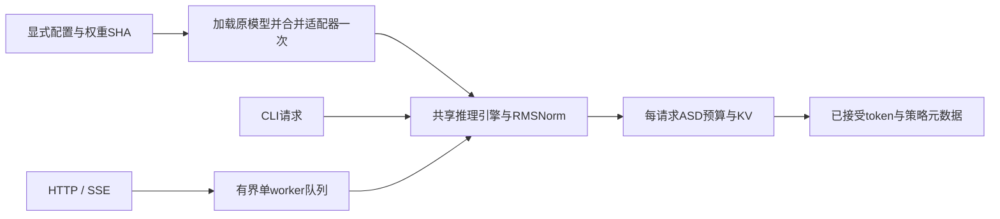

# 数学ASD运行配置与位置适配

这两个显式配置把已测的数学ASD方案接入同一个CLI/HTTP运行时。适配器在模型启动时合并进原dense Draft，每个请求独立维护ASD预算。已测适用场景为Qwen3-8B/DFlash b16的GSM8K数学生成；CPU demo和本机RTX3090不承担这份8B/FP32配置的性能验证。

|配置|Draft|调用方法|执行profile|
|---|---|---|---|
|configs/runtime-dflash-asd.json|原DFlash|ASD|rmsnorm-inductor|
|configs/runtime-dflash-asd-position.json|位置匹配严格前缀适配后DFlash|ASD|rmsnorm-inductor|

两配置也保留严格AR、DFlash、R+DFlash。ASD使用B=8、gate=.25、cap=2、remaining/longest；请求返回approximate=true，允许输出与Target greedy不同。适配版在已有独立16题上128 token时延降低3.23%、验证调用331→319，未新增答案错误；完整自然7.32%包含错误长路径缩短，质量和事后正确题分析见[实验报告](ASD_ADAPTATION_FOLLOWUP_FINDINGS.md)。这些是已完成研究的结果，本次接入验收另列。

## 准备和CLI

使用已准备的A6000 Linux、Torch2.5.1+cu124、Transformers4.57.3及本地已审计模型。安装接口依赖沿用`python -m pip install -e ".[dflash,serve,client,test]"`；服务加载适配器不需要PEFT训练依赖。模型/adapter不随Git分发，运行时不自动下载。

在项目目录中，从本机已有的已接纳checkpoint准备标准路径：

```bash
python -m scripts.prepare_asd_runtime_adapter --source ../asd-adaptation-followup/artifacts/followup-adapter/selected.safetensors
python -m memorydraft infer --config configs/runtime-dflash-asd-position.json --request examples/request-asd.json --method ASD --output artifacts/asd-answer.json
```

第一条命令校验SHA后准备artifacts/adapters/asd-position.safetensors，重复运行只验证相同文件；已有内容不匹配则报错。若checkpoint位于其他本地目录，用--source指定。原ASD只需将--config改成configs/runtime-dflash-asd.json，不需要适配器。输出文件应使用新路径。

结果包含approximate、asd账本、draft_adapter_sha256、execution_profile、token IDs、文本、EOS/长度原因、请求耗时及TTFT。SHA固定为42755672a816b44b727cbc5bcdbbd2b18dd2a19db42e5706f09d540d678b1f6e；加载阶段校验原DFlash资产，再核对适配器dtype、投影形状和有限值。合并准备耗时在engine.describe的draft_adapter.setup_seconds单列，首次编译留在首个生成请求内。

## HTTP与SSE

```bash
python -m memorydraft serve --config configs/runtime-dflash-asd-position.json --host 127.0.0.1 --port 8000
```

另一个终端调用：

```bash
curl -N -H "Content-Type: application/json" --data-binary @examples/request-asd-http.json http://127.0.0.1:8000/v1/generate
```

Windows PowerShell可用curl.exe执行同一组参数。示例请求开启SSE；JSON请求将stream改成false。/healthz列出approximate_methods和draft_adapter_sha256。SSE顺序为start、tokens、complete；ASD的start包含approximate:true，complete附完整账本，tokens拼接必须等于complete.token_ids。ASD接受的token按其近似规则提交。

接口沿用有界单worker队列，timeout包含排队，满队列429，断连/取消在解码边界生效。不同请求不共享KV或ASD剩余预算，取消不会写回部分答案。HTTP并发请求排队执行。更换adapter或ASD策略需要重新加载engine；不支持每请求切换权重或R+ASD组合。

## 验收和架构

```bash
python -m scripts.validate_asd_runtime --config configs/runtime-dflash-asd-position.json --output artifacts/asd-runtime-check
```

该命令使用4道已观察数学题检查冻结轨迹、严格AR、直接流式、取消恢复、HTTP/SSE和小队列；输出目录须新建。完整双配置+独立CLI冷启动验收由scripts.run_asd_runtime_pipeline在全新部署目录执行，资源/题目/判定见[固定协议](ASD_RUNTIME_PROTOCOL.md)。原benchmark和check_regression只接受严格方法；ASD服务吞吐可用load-test采集HTTP观测，结果不自动宣称质量或无损加速。



默认严格运行配置、原面试版及历史H/D/R/OT实现继续保留。本配置是已测数学近似解码的显式使用入口。

已完成的[工程验收](ASD_RUNTIME_RESULTS.md)保留两配置32直接结果、8 AR和2次CLI，以及真实HTTP/SSE/取消恢复证据。冷CLI的累计spent存在小于1e-5的数值差异，原零容差失败与后处理比较修正见[数值说明](ASD_RUNTIME_NUMERICS.md)；这不改变实际预算或解码规则。未来pipeline只对独立CLI账本比较使用该容差，普通直接/HTTP仍精确比较。
