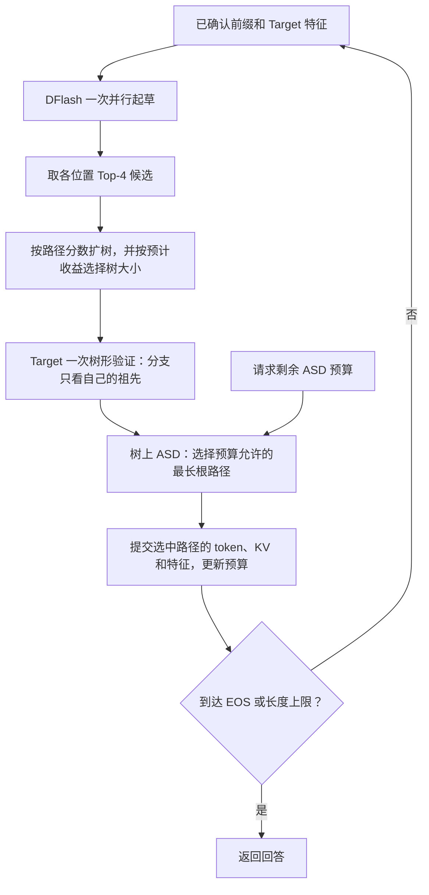

# 树 + ASD：让大模型一次验证，推进更多 token

> 本文保留**早期 BudgetTree-ASD** 的架构与当时实测，下文“最新一轮”均指该阶段。后续已加入兄弟分支 JS 门控、当前 token 分歧上限、反馈调宽、最小增量接受和执行优化；了解目前完整算法请先读[当前算法通俗说明](CURRENT_ALGORITHM_GUIDE.md)。历史结果不随版本更新而改写。

树 + ASD 是本项目已经实现并完成多任务评测的解码架构，实验名称为 **BudgetTree-ASD**。它在现有 DFlash 起草器和 ASD 验证规则之间加入一个成本受控的候选树模块，让同一次大模型验证覆盖更多有价值的接续，再选出预算允许的最长路径。

在最新一轮独立扩样中，相对普通 ASD，组合在 GSM8K、MBPP、Alpaca 上分别降低自然请求时延 **7.72%、10.21%、17.89%**；MT-Bench 使用各方法自身历史的双轮对话时延降低 **12.93%**。它已经体现出跨任务的实际加速价值。本文重点解释这套架构怎样运作，以及收益从哪里来；完整数据见[七任务结论](ASD_PAPER_EXTENSION_FINDINGS.md)和[完整实验表](ASD_PAPER_EXTENSION_RESULTS.md)。

## 1. 先认识三个角色

|角色|负责什么|通俗理解|
|---|---|---|
|Target，大模型|验证候选，给出每个位置的偏好和下一 token|负责检查和定稿的人|
|Draft，起草器|快速提出一小段未来 token 的候选分布|提前准备草稿的人|
|验证与选路模块|决定本轮哪些候选能成为实际输出|决定采用哪条草稿的人|

token 是模型处理文字的基本单位，可以先把它理解成一个字、词或词的一部分。KV 缓存保存模型已经算过的上下文状态，避免每次从头计算。

本项目的底座是 **Qwen3-8B Target + 与其匹配的 DFlash Draft**。DFlash 利用 Target 的中间特征，一次并行预测多个未来位置。当前实验保留原生 16 位置窗口：一个 Target 已确定的锚点 token，加上最多 15 个待验证候选位置。

## 2. 普通线性候选为什么会浪费机会

通常，每个未来位置只取 Draft 最看好的一个 token，拼成一条线：

```text
已确认前缀 → 锚点 → 甲 → 乙 → 丙 → 丁 → 戊
```

Target 可以在一次前向计算中检查这整段，但严格验证只能采用从头开始连续匹配的部分。假如 Target 在“乙”处更偏好另一个 token，那么线性草稿的可接受前缀就可能提前结束。

ASD 已经提供了一种有效办法：如果某次分歧的代价足够小、后面还有可复用的位置，就在受控预算内接受这个分歧，继续使用后面的计算。它用 Target 对两个 token 的 logit 差值记录这笔代价，称为 regret。

但线性 ASD 面对的仍然只有一条候选路径。如果当前路径上的分歧超过门控或剩余预算，它就需要结束本轮，即使 Draft 的其他高排名候选可能组成一条更合适的接续。

**成本树补上的，就是这些原本没有交给 Target 检查的替代路径。**

## 3. 树怎样与 ASD 配合

下面是便于理解的示意，不是某次实测的 token 轨迹。假设 Draft 在第二个位置还给出了候选“乙′”：

```text
已确认前缀
└─ 锚点
   └─ 甲
      ├─ 乙  → 丙 → 丁 → 戊
      └─ 乙′ → 丙 → 丁 → 戊
```

假设线性路径上的“乙”未通过 ASD 门控，而另一条路径上：

1. “乙′”正好是 Target 在该前缀下的首选。
2. 后面的“丙”也能通过验证。
3. “丁”存在一个 ASD 预算允许的小分歧。
4. “戊”在这条实际路径的上下文下又符合 Target 的首选。

那么树 + ASD 就能沿第二条路径继续推进。**树提供更多可选路径，ASD 让合格路径越过少量受控分歧；最终只采用其中一条连续路径。**

这里每条分支上的“丙、丁、戊”都是各自独立的树节点。Target 会结合该分支自己的祖先计算，不能把一条分支的判定拿来给另一条分支使用。

这种配合在逻辑上很自然：树改善候选的覆盖范围，ASD 改善已验证候选的利用方式。两者都围绕“本轮能连续提交多少 token”工作。

## 4. 实际的一轮解码怎样执行



### 第一步：复用一次 Draft 的候选分布

DFlash 已经计算了各未来位置的词表分数。线性方法只保留每个位置的 Top-1；树模块进一步取 Top-4，组合出多条接续。

这些分数来自同一次并行起草。当前实现复用位置分布来构树，新增分支不需要分别再调用 Draft；分支改变后，也不会为它重新计算一份条件化的 Draft 分布。各分支的真实条件偏好留给后面的 Target 验证。

### 第二步：优先保留更有希望的路径

为每个节点计算一个路径分数：从根走到这个节点，各位置 Draft 概率的乘积。算法每次优先加入路径分数更高的待扩展节点，同时保留它的全部祖先。

这样做会把有限节点优先分给 Draft 更看好的组合，而无需枚举 Top-4 在所有位置上的全部组合。路径分数是候选排序和预计推进量的代理；真正采用哪条路径，由 Target 和 ASD 共同判定。

### 第三步：树的大小也要算账

树越大，覆盖的候选越多，验证和管理成本也会增加。因此当前实现最多构建 32 个节点，在通常 8～32 个节点的候选规模中，选择下面这个比值最大的规模：

```text
树的预计效率 = 预计每轮推进量 / 预计每轮耗时
```

预计推进量由树内各节点的路径分数之和给出，根节点的分数为 1。预计耗时包含 Draft、构树辅助成本，以及当前上下文长度和节点数对应的验证成本。验证成本表在实际 GPU 上预先测量，再按规模和上下文估计；建表与模型加载成本单列记录。

所有树都至少包含根；遇到 EOS 时，该节点不再向后扩展。如果可扩展候选提前耗尽，树可以小于通常的 8 节点下限。

**这个设计把问题从“尽可能多猜一些”变成了“为每单位时间准备更有用的候选”。**

### 第四步：Target 一次检查整棵树

树的节点排成一批交给 Target，但每个节点使用自己的树深度作为位置，并通过 attention mask 限制可见范围：已经确认的前缀、自己的祖先和自己。兄弟分支互相隔离。

因此，多条路径可以共享一次 Target 前向调用，同时得到各自上下文下的验证结果。这会增加单轮的计算量和缓存占用，但有机会用较小的单轮成本增幅换取更多连续输出。

### 第五步：在树上执行 ASD 规则

对每条父节点到子节点的边，用父节点的 Target 输出判断这个子 token：

```text
regret = Target 首选 token 的 logit − 当前候选 token 的 logit
```

如果 token 与 Target 首选完全相同，就严格通过；如果不同，则检查局部门控、每轮例外数和请求剩余预算。主实验使用：

|参数|主配置|含义|
|---|---:|---|
|请求总预算 B|8|整条回答累计允许消耗的 regret|
|局部门控 γ|0.25|当前分歧的 regret 除以原生窗口剩余位置数，必须不超过该阈值|
|每轮例外上限 m|2|一次验证中选中路径最多包含两个非首选 token|

局部门控的分母取决于原生窗口还剩多少位置，不随树变宽而增大。树提供更多选择，但不会因为增加分支就扩大同一次请求的 ASD 预算。

在所有可行的连续根路径中，选择最长的一条；长度相同时选累计 regret 更小的路径，再用稳定节点顺序打破平局。只对最终选中的路径扣费，其他分支不消耗请求 regret 预算。regret 衡量的是模型偏好差距，最终答案质量仍用任务评分器检查。

### 第六步：只提交选中路径的状态

采用路径之后，将其 token、Target KV 和中间特征整理成连续前缀，舍弃其余分支状态；在路径末尾取得 Target 给出的下一 token，作为后续的恢复或额外 token。到达 EOS 或长度上限时按停止规则结束。

接下来，Draft 从这条已经实际采用的历史继续起草。这样，候选树中的其他分支不会混入后续上下文。

## 5. 为什么增加一个模块，反而能更快

生成时延可以近似拆成：

```text
总时间 ≈ 首次处理输入的时间
       + 验证轮数 × 每轮平均成本

验证轮数 ≈ 输出长度 / 每轮实际推进量
```

树会增加每轮成本，但如果每轮推进量增加得更多，整条请求就会更快。以一组纯说明数字为例：每轮从推进 4 token、耗时 10 ms，变成推进 6 token、耗时 12 ms，每 token 的轮内成本就从 2.5 ms 降到 2 ms。固定工作量下约节省 20%；这组数字只是解释原理，不是本项目的测速结果。

最新一轮实验已经观察到这条机制链。下表的接受长度与验证轮次来自自然停止任务的首个重复，时延来自正式配对计时：

|任务|每轮实际 Draft 接受长度：ASD → 树+ASD|验证轮数：ASD → 树+ASD|自然请求时延下降|
|---|---:|---:|---:|
|GSM8K|5.440 → 6.648|5673 → 4750|7.72%|
|MBPP|4.564 → 5.879|567 → 463|10.21%|
|Alpaca|1.951 → 2.848|7489 → 5578|17.89%|

这里的接受长度只统计实际提交的 Draft token，排除 Target 锚点和恢复/额外 token；节点多不等于接受多，最终只统计选中路径。轮数是该任务集合的合计。

GSM8K、MBPP 的逐题输出长度比均值分别约增加 0.47%、2.27%，仍然更快；Alpaca 约缩短 2.15%。在遵守 EOS 的共同 128-token 工作量上，GSM8K 和 Alpaca 也分别省时 9.63%、18.36%。这些结果说明，收益中包含了**减少验证轮次带来的计算效率提升**。

正式模型请求计时包含起草、Top-K、构树、数据传输、mask、Target 验证、选路和 KV 整理等在线步骤。模型加载、冷编译与成本表校准另列；这里的数字不包含 HTTP 排队和网络传输。

## 6. 怎样理解本项目的成果

这套架构把已有的两类有效思想接到了一起：成本感知的树形候选，以及 ASD 的请求预算化近似验证。项目完成了候选生成、树形注意力、路径判定、预算记账、KV/特征提交的整条链路，并在同一模型与执行配置下测量组合的增量收益。本轮沿用相同的 Target/Draft 权重，无新增适配训练，RMSNorm 等已有执行优化也在对照组中保持一致。

其中，构树借鉴 [BASTION](https://arxiv.org/html/2605.29727v1) 的路径分数和 best-first 思路，在本项目中使用实际硬件计时表控制规模；近似判定沿用 [ASD](https://arxiv.org/html/2608.03447v3) 的 regret、局部门控、请求预算和例外上限。相关实现范围与上游版本记录见[树实验协议](ASD_TREE_PROTOCOL.md)。

两条已验证的使用路径可以分别保留：

|版本|候选组织|接受规则|本轮证据|
|---|---|---|---|
|BudgetTree，严格成本树|成本受控候选树|严格匹配 Target 首选|530 个自然请求与 DFlash 输出一致，六类任务时延下降约 2.64%～17.15%，MMLU 基本持平|
|BudgetTree-ASD，树+ASD|成本受控候选树|预算内的树上 ASD|相对普通 ASD，在数学应用题、基础编程和自由生成等任务中取得实际时延收益|

组合的最新自然请求结果包括：GSM8K 正确 114→117/128，MBPP 正确 31→32/64，同时分别省时 7.72%、10.21%。开放任务中，Alpaca 省时 17.89%；MT-Bench 匹配单轮省时 5.51%，按对话合并两轮省时 10.12%，自身历史双轮省时 12.93%，这些统计范围分别报告。

也有需要按应用权衡的情况：MATH-500 慢 5.50%、正确 44→45/64；HumanEval 快 3.26%、正确 53→52/64；MMLU 略慢且输出格式合同评分下降。MATH 正确数采用事先规定的有限标量等价补充口径，与完整表一致。开放偏好代理对组合相对 ASD 的胜率为 MT 50%、Alpaca 46.09%（平局计半）。这些变化与近似路径和自然输出长度有关，完整分析保存在结果报告中。

**本项目已经证明了这套组合在多个标准任务上的实用加速价值，也给出了适用场景和代价。其核心收益是：用可控的额外候选计算，提高一次验证的实际推进量。**

## 7. 对照实现时从哪里读

|文件|对应本文的部分|
|---|---|
|[budget_tree.py](../memorydraft/backends/budget_tree.py)|硬件成本估计、候选树构造、树上 ASD 路径选择|
|[draft_tree.py](../memorydraft/backends/draft_tree.py)|树的数据结构、祖先 attention mask、选中路径的 KV 提交|
|[dflash_reuse.py](../memorydraft/backends/dflash_reuse.py)|一轮起草、验证、选路和状态提交的实际执行循环|
|[asd.py](../memorydraft/backends/asd.py)|原线性 ASD 的预算、regret 与前缀判定规则|
|[run_asd_tree.py](../scripts/run_asd_tree.py)|成本表校准和 DFlash / ASD / 严格树 / 树+ASD 四组执行入口|
|[test_budget_tree.py](../tests/test_budget_tree.py)|构树、EOS、预算、实际路径 KV 与后续生成的检查|

本文讲解的主方法是 BudgetTree-ASD。后续 Joint 变体进一步让剩余预算参与主干预留，独立说明见[联合构树协议](ASD_JOINT_TREE_PROTOCOL.md)；本文所列收益均归属原成本树组合。
