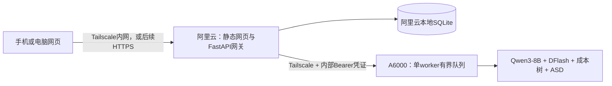

# MemoryDraft 朋友聊天网页

新版的模型／模式选择、真实草稿与树图、事件接口及可选大模型说明见[聊天过程可视化](CHAT_VISUALIZATION.md)。本页下方首版验收的 SHA 和数量保留，后续界面与长度验收分别保存在 `results/chat-visualization/`、`results/chat-inline-ui/`、`results/chat-long-output/`。

浏览器通过阿里云登录、读取自己的会话，并接收流式文本。阿里云只安装`.[web]`，不需要Torch或模型权重；A6000复用已验收的DFlash、成本树和ASD推理运行时。旧infra v0.3/v0.4的冻结分支、标签、独立副本不修改。



## 首版行为

- 邀请码注册，用户名/密码登录；7天HttpOnly、SameSite=Strict会话Cookie。密码使用每账号独立随机盐的scrypt，数据库只存哈希；会话令牌同样只存哈希。
- 会话、消息和密码哈希仅落在阿里云SQLite；服务不记录请求正文或访问日志，不向外部CDN、分析服务或模型API发送内容。A6000收到本次推理需要的历史，不开启聊天落库。
- 用户身份由网关会话确定，浏览器不能指定`user_id`、模型方法或ASD预算。修改接口必须有正确Origin和会话CSRF令牌；所有会话操作校验所属用户。
- 默认`BudgetTree-ASD`、最多两人活跃、每人一次生成。首版输出上限为1024 tokens，长输出设置见下节；这是上限，模型仍可自然提前结束。GPU串行执行，第二个请求等待；这不是两路并行批处理。ASD沿用已有近似预算，不能保证与严格解码输出相同。
- 超出上下文时，以A6000实际tokenizer及相同chat template计算，按完整轮次删去最旧输入；原完整聊天记录继续保留。只把完成的历史回答放入后续上下文；停止、失败、断线和重启中断都单独标记。
- 原SSE token接口保持兼容。只有`text_stream=true`才额外解码已提交前缀、发送可替换文本快照；最终完整文本以complete为准，不拼接单token解码。网页停止或断开会关闭上游连接，A6000在验证轮次边界协作取消。
- 原生HTML/CSS/JavaScript，无前端构建步骤；支持手机布局、基础Markdown、代码块、历史删除。首版不含附件、语音、完整数学公式排版或邮件找回密码。HTTP内网环境的浏览器剪贴板权限可能不可用，可手动选中复制。

## 内网部署

当前网页单次输出由 `MEMORYDRAFT_CHAT_MAX_TOKENS=16384` 控制，网关和推理任务的总等待／生成期限由 `MEMORYDRAFT_CHAT_TIMEOUT_SECONDS=3600` 控制。Qwen3-8B 的运行配置需同步设置 `max_new_tokens: 16384`；研究 runtime 的默认值仍为1024，原冻结实验不改。两个模型的历史加当前输入上限仍为8192 tokens。模型输出EOS或用户停止仍会提前结束，不会为了凑满上限强制续写。

27B 原生窗口扩大到32768，为长输出保留容量；适配器从 `/props` 发现真实窗口，并按 `min(8192, 总窗口 - 请求输出预算)` 判断输入，不再硬编码12288。不能只提高网关数字而忽略原生窗口。满输入下的峰值还受模型、KV和注意力工作区影响，不把短输入的输出上限实测当作所有极限组合都已验证。

实际机器地址和密钥不写入仓库。模板见`deploy/chat/`，服务运行一个Uvicorn worker；多worker会破坏当前流任务所有权和重启恢复，不能直接增加workers。

1. A6000准备独立源码目录及已校准的运行配置；沿用相同GPU型号、执行profile、模型revision和成本表SHA。把随机内部凭证放到权限600的`inference.env`：`MEMORYDRAFT_API_KEY=...`。
2. A6000启动：`python -m memorydraft serve --config /path/to/runtime.json --host YOUR_A6000_TAILSCALE_IP --port 8010 --queue-capacity 2`。环境加载内部凭证；健康、token计数、生成接口均需要Bearer凭证。不要绑定公网地址。
3. 阿里云创建venv并运行`python -m pip install '.[web]'`。按`gateway.env.example`生成私有环境文件，内部凭证与A6000一致，邀请码使用另一随机值。数据库目录权限700。
4. 加载环境后启动：`python -m memorydraft.chat --host YOUR_ALIYUN_TAILSCALE_IP --port 8080`。通过systemd模板保持运行并恢复；网关数据库应在源码release目录之外。
5. 手机或电脑加入获准的Tailscale网络后，浏览器打开`http://YOUR_ALIYUN_TAILSCALE_IP:8080`。这是通过Tailscale加密隧道的内网HTTP，仅允许loopback或Tailscale绑定；不提供公网明文账号入口。

建议在Tailscale访问控制中只允许朋友访问网关端口，只允许阿里云访问A6000推理端口。两个端口的Bearer/账号鉴权仍保留；没有通过内网域名推断用户身份。[Tailscale官方访问控制](https://tailscale.com/docs/features/access-control)

没有域名时先完成内网使用。后续配置公网域名、HTTPS、成都服务器适用的备案要求后，使用Nginx模板代理到loopback，并将`MEMORYDRAFT_PUBLIC_ORIGIN`设为精确的HTTPS origin；网关自动启用Secure Cookie。Nginx关闭响应缓冲以保留流式输出。[Nginx代理说明](https://nginx.org/en/docs/http/ngx_http_proxy_module.html)、[阿里云备案说明](https://help.aliyun.com/zh/icp-filing/basic-icp-service/support/for-the-record-process-faq)

## 运维与验证

部署文件打包：`python -m scripts.package_chat_service --output artifacts/chat-source.zip`。只包含应用源码、必要静态资源和包元信息；SHA清单标识部署源码，排除数据库、私有环境文件、模型和历史trace。

阿里云数据建议用SQLite的在线backup API生成一致快照。运行中不能只复制主`.sqlite3`文件，因为WAL里可能还有新消息；若保留备份，用户删除会话后备份中的旧数据应按约定清理。数据库和备份不提交GitHub。

已部署后检查：`systemctl status memorydraft-chat`、A6000用户服务`systemctl --user status memorydraft-chat-inference`；只有已配置user lingering时，A6000用户服务才能在注销后和开机时独立运行。进程日志仅用于运行错误，不打印环境文件。

验证命令：`python -m pytest -q tests/test_chat.py tests/test_serving.py tests/test_runtime_cost_tree.py tests/test_runtime_asd.py`，及`node --check memorydraft/chat/static/app.js`。CPU模拟、真实GPU、真实跨机TCP及浏览器检查分别报告，不把模拟输出记为模型实测。

安全设计参考：[OWASP密码存储](https://cheatsheetseries.owasp.org/cheatsheets/Password_Storage_Cheat_Sheet.html)、[OWASP CSRF防护](https://cheatsheetseries.owasp.org/cheatsheets/Cross-Site_Request_Forgery_Prevention_Cheat_Sheet.html)、[HTTPX流式关闭连接](https://www.python-httpx.org/async/)。本项目采用scrypt N=2^15、r=8、p=3，限制同时两次密码校验，避免小内存服务器被并发哈希挤占。

## 2026-10-27验收

完整回归1156项通过、7项跳过；服务/ASD/成本树专项69项通过。首版6次真实跨机流式请求验证注册隔离、历史、排队、停止和恢复；随后在真实Chrome验证代码回答、390×844手机布局、会话导航和停止按钮。服务重启后登录与历史保留，最终release再次真实恢复生成通过，页面无JavaScript错误。临时合成测试账号已清理。

证据与源码身份见[验收记录](../results/chat-deployment/acceptance.json)、[首版跨机原始结果](../results/chat-deployment/cross-host.json)。最终两机101文件源码SHA为`704189f767b142efd20cd1496000949a51b80e319c2b885a6f8720cbc3d99b3d`；首版和最终版的模型推理/网关Python代码相同，最终差别是手机标题、Markdown空行、favicon及README。部署清单记录实际打包字节，可能包含Windows工作区换行，不将其混作Git树哈希。

这些检查证明当前小规模服务链路可用；耗时包含冷编译、队列及网络，不作为算法加速对照或更高并发容量承诺。当前模型常驻A6000 GPU0；后续进行同卡研究计时时应先停止聊天推理服务，或选空闲GPU并独立确认配置。

## 客户端出现HTTP 502

先比较直连和代理路径：`curl --noproxy '*' http://YOUR_ALIYUN_TAILSCALE_IP:8080/`。如果服务器和客户端直连均为200，而走本机代理为502，应将阿里云的具体Tailscale IP加入系统代理排除列表；不是只确认Tailscale显示在线。Windows内置的“本地地址绕过”不一定覆盖这个IP，需要明确添加。[Windows代理设置说明](https://support.microsoft.com/en-us/windows/experience/connectivity-networking/use-a-proxy-server-in-windows)

2026-10-27用户实际访问故障中，保留现有Windows代理及其其他排除项，仅追加聊天服务器IP，并刷新系统代理配置后，未带禁用代理参数的独立Chrome成功打开登录页。修改前的排除列表保存在本机忽略目录`artifacts/chat-deploy/proxy-bypass-backup-*.json`，不上传到仓库。用户已有浏览器可刷新页面，必要时关闭该标签页后重新打开；手机等其他设备需独立确认Tailscale和代理绕过设置。

随后用户反馈原Chrome仍为502，说明上述新会话检查不足以确认实际客户端恢复。进一步检查Clash日志发现：原规则已经把整个Tailscale网段交给DIRECT，但其拨号仍超时。Windows正常直连使用Tailscale源地址，运行中的Clash却使用以太网源地址并停在SynSent。临时隔离实例的对照中，全局绑定以太网返回502；以太网全局绑定保持时，给专用select组指定`interface-name: Tailscale`则返回200。

最终只为聊天地址添加以下专用组和前置规则，其他原有组、规则、端口和代理模式保留。示例应合并进已有列表，不能用它替换整份订阅；替换示例IP后使用。

```yaml
proxy-groups:
  - name: MemoryDraft-Tailscale
    type: select
    proxies: [DIRECT]
    interface-name: Tailscale
rules:
  - IP-CIDR,YOUR_ALIYUN_TAILSCALE_IP/32,MemoryDraft-Tailscale,no-resolve
```

用安装包自带Clash `-t`校验后加载，核对原有12个selector组的选项全部相同；强制经过原Clash端口访问由502变200，客户端直连仍为200，用户也确认原Chrome已显示登录页。当前修改写入正在使用的本地profile；订阅自动更新可能覆盖手工内容，长期使用应通过Clash Mixin/预处理保留专用组和规则。原配置备份仅在本机忽略目录`artifacts/chat-deploy/clash-*-backup-*`，含私有订阅数据，不得提交GitHub。本轮没有更换Clash版本、全局改变出口网卡或开启TUN。

2026-10-27再次发生502：服务器和电脑直连均200，强制经过Clash为502。当前订阅文件在21:24被改写，专用组及单IP规则已缺失；恢复该组／规则后，当前代理首页与脚本均200，12个原selector选项、9816条原规则、11个原组保留，用户确认原Chrome恢复。网页服务仍为树流版本，无需回滚。

为保留更新后的路由，在Clash for Windows 0.19.10「设置 → 配置 → 配置文件预处理」中保存了预处理器，并重新打开确认保存。可复用模板是 [clash-preprocessor.example.yml](../deploy/chat/clash-preprocessor.example.yml)：先替换Tailscale IPv4，再把其中条目合并进现有`parsers`数组，不覆盖其他用户预处理器。模板为HTTP(S)订阅更新补回这一个主机的专用组与前置规则；重复运行会去重，其余配置保持。保留旧专用组名是为了兼容已有配置，与网页品牌无关。

该版本安装包源码确认了`reg`／`code`及 `module.exports.parse(raw, { yaml })` 接口。预处理器不调用网络、不改变订阅URL；当前订阅副本通过幂等、其他设置保持和核心`-t`检查。为了不更换正在使用的节点，没有实际刷新远程订阅，因此不将本轮结果声称为订阅刷新后的端到端测试。模板测试命令：`node --test tests/clash_preprocessor.test.cjs`。安全结果见 [恢复记录](../results/chat-route-recovery/acceptance.json)，原订阅和带凭据备份只保留本机忽略目录。
