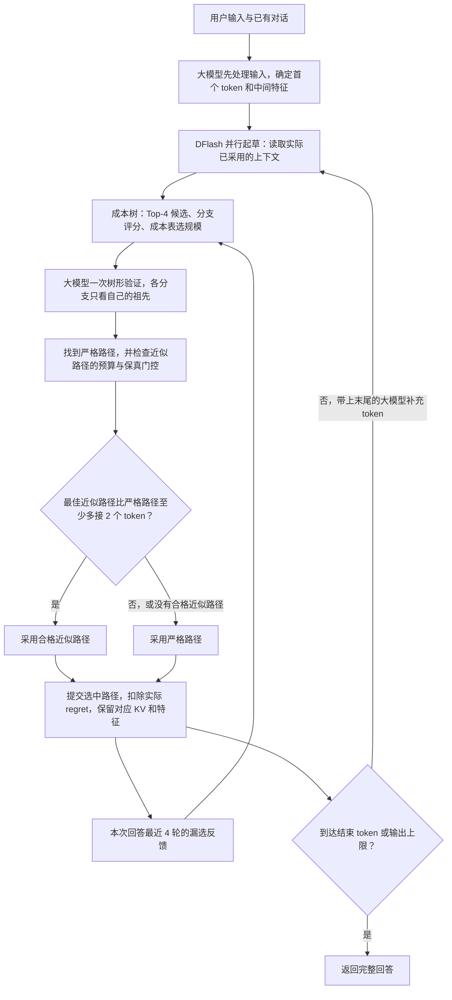

# 当前算法通俗说明：DFlash + 高保真反馈成本树 + ASD

这套算法的核心是：**让小模型提前准备多条接续，大模型一次检查整棵候选树；在控制偏移的前提下，选出能多推进一些文字的路径。**

可以把它理解成写作与审稿的配合：DFlash 负责快速拟稿，成本树负责安排值得检查的备选，大模型负责检查，ASD 和新增门控共同决定哪些内容可以定稿。每轮只采用一条路径，然后沿着这条实际输出继续生成。

本文对应截至 **2026-11-02** 已完成评测、已接入 infra v0.5 的版本。先读本文了解流程，再看[完整实验总表](ASD_TREE_EXPERIMENT_SUMMARY.md#all-baselines)或[部署指南](INFRA_FIDELITY_GUIDE.md)。

## 1. 先把几个名字对上

|名字|在这套算法里做什么|
|---|---|
|Target，大模型|本轮负责检查和给出偏好的模型；当前主要实验使用 Qwen3-8B|
|DFlash，Draft 起草器|与 Qwen3-8B 匹配的 `Qwen3-8B-DFlash-b16`，利用大模型中间特征，并行预测后面多个位置|
|成本树|把 Draft 各位置的高排名候选组织成多条路径，控制树的大小和分支分配|
|ASD|允许在预算内采用少量并非大模型首选的 token，以继续利用后面的候选|
|保真门控|在 ASD 之外，检查当前分歧及其对下一步预测的影响，限制容易造成偏移的接续|
|反馈调宽|根据本次回答最近几轮的漏选情况，调整后续树的分支分配|
|最小增量接受|近似路径至少比同一棵树的严格路径多接 2 个候选 token，才值得采用|

token 是模型处理文字的单位，可能是一个字、一个词或词的一部分。下文用“接几个 token”表示本轮采用多少个待验证候选；这与屏幕上的汉字数并不相同。

研究表中的当前版本叫 **`BufferedKV-ASD`**。正式运行时仍使用方法名 **`BudgetTree-ASD`**，再通过 `tree_policy.mode = "min-gain-feedback"` 启用本文的策略。省略这个策略的旧 `BudgetTree-ASD` 使用早期规则，两者应区分。

这套当前路径从 DFlash 生成树候选；早期的历史辅助 H、检索 R、OT-R 保留在仓库的其他研究模块中。它们各有独立实验，本文所述收益归属于当前树解码路径。具体网页模型是否开放该路径，以后端实际配置为准。

## 2. 从普通生成到当前方案，逐层增加了什么

假设模型正在续写一句话：

```text
已经确定的文字 → 接下来要生成的内容
```

**普通 AR：大模型逐个生成。** 每次运行大模型，确定下一个 token，再重复。它是本项目比较输出一致性的参考方法。

**DFlash 投机解码：先猜一段，再一起检查。** 小模型一次猜多个未来位置，大模型通过一次前向计算检查整段。如果草稿与大模型首选连续一致，就一次采用多个 token；遇到分歧则在那一处使用大模型给出的 token，后面的草稿暂时放弃。

**严格成本树：给大模型更多备选。** 单条草稿猜错时，另一条分支可能恰好猜对。把几种接续放进同一轮检查，可以增加连续命中的机会；采用规则仍是逐步匹配大模型首选。

**树 + ASD：允许少量受控分歧。** 某个候选虽然不是大模型第一选择，但差距较小，而且后面还有能采用的内容，就可能在预算内继续走这条路。

**当前版本：进一步约束分歧，并提高每轮计算的利用率。** 新增“换这个 token 后，下一步预测改变多少”的检查、根据漏选反馈分配分支、至少多接 2 个 token 才近似接受；另外复用分数与 KV 存储，减少重复计算和搬运。

|方法|候选形状|允许非首选 token 吗|主要作用|
|---|---|---|---|
|AR|逐个生成|按大模型 greedy 首选输出|参考输出|
|DFlash|一条线|严格验证下不允许|一次检查多个位置|
|BudgetTree，严格成本树|多条路径|不允许|用备选路径提高覆盖|
|普通 ASD|一条线|预算允许时接受|越过部分局部分歧|
|当前高保真树 + ASD|成本受控的多条路径|通过新增门控、预算和增量检查才接受|兼顾推进量、偏移与执行成本|

当前评测以 greedy 解码为基础。严格验证旨在保持相同 Target 配置下的 AR 输出；ASD 是显式近似解码，会改变生成路径。“更接近 AR”和“最终答案更正确”也需要分别评价。

## 3. 一次回答的完整流程



**大模型在最开始先处理输入。** 这一步叫 prefill，会计算当前请求和对话的状态，给出第一个确定的 token，以及 DFlash 所需的中间特征。

之后进入重复循环。每轮的起点都有一个大模型已经确定的 token，称为“锚点”。它是树的根，已经属于输出，展示时不会重复出现。当前 DFlash 原生窗口有 16 个位置：**1 个锚点 + 最多 15 个待验证候选位置**。

### 3.1 DFlash 先快速预测多个位置

DFlash 读取已采用上下文对应的大模型特征，一次并行给出多个未来位置的词表分数。线性方法通常只取各位置第一名；树模块进一步取各位置的 Top-4。

这些分数来自同一次起草。树新增分支时，复用对应位置的 Draft 分布，不会为每条新分支重新运行一次 Draft。分支是否真的适合它自己的上下文，交给接下来的大模型检查。

并行草稿中可能出现重复或不通顺的候选；它们能否成为实际输出，由验证规则决定。树的作用是增加可选接续，不能替代检查。

### 3.2 成本树决定“检查哪些路径、检查多大一棵树”

树模块优先加入 Draft 分数更好的组合，并保留每个节点的祖先。例如：

```text
已确定前缀 → 锚点
                 ├─ 候选 A → 候选 B → ……
                 └─ 候选 a → 候选 B → ……
```

图中的两个 B 是两个独立节点：一个接在 A 后面，一个接在 a 后面。即使文字相同，上下文也可能不同。

当前典型配置使用 8～32 个总节点，**根节点也计入节点数**。32 个节点表示整棵树的计算预算，不表示最后一次输出 32 个 token；树的深度仍受本轮最多 15 个候选位置限制。遇到结束 token 不再扩展，可扩展候选不足时，树也可以小于通常的下限。

树的规模按下面这个目标选择：

```text
预计效率 = 预计推进量的代理分数 / 预计一轮耗时
```

每条边先取得候选分数，从根走到某个节点，把沿途分数相乘，就得到该节点的路径分数；根的分数为 1。代理分数再把树中节点的路径分数相加。当前边分数还受旁支惩罚影响，具体作用见第 6 节。

这个分数用于比较候选树，不是“大模型一定接受多少”的精确预测。预计耗时包含 Draft、构树辅助成本和大模型验证成本，验证成本通过实际硬件上的计时表估计。

这样，算法会在“加一些备选”和“这一轮算得更贵”之间取舍。成本表提前校准，实际请求的全部在线步骤仍计入性能测试。

### 3.3 大模型一次检查整棵树

树节点排成一批送入大模型。每个节点只能看到已经确定的前缀、自己的祖先和自己，不能看到兄弟分支；位置编码使用它在树中的深度。

这相当于在一次大模型调用里，检查多种不同接续。**批量检查候选不等于模型一次独立生成整篇回答**：每个位置的判断仍然依赖那条分支的前文。

这一轮产生的信息包括：每个节点之后大模型最想输出什么、其他 token 的分数，以及后续门控要用到的完整词表分布。

## 4. 怎样决定哪些 token 能被采用

先找出同一棵树中严格匹配大模型首选的连续路径，作为本轮的保守选择。然后检查是否存在值得采用的近似路径。

近似路径需要同时满足下面这些条件。

### 4.1 当前 token 的偏好差距不能太大

在同一个前缀下，设大模型首选为 A，正在考虑的候选为 a：

```text
regret = 大模型给 A 的 logit − 大模型给 a 的 logit
```

logit 可以理解为模型给 token 的原始偏好分数。差距越小，说明模型对这两个选择的偏好越接近。当前额外要求单个分歧的 regret 不超过 **ln(4)，约 1.386**。

从同一位置的概率看，这等价于候选概率至少达到首选概率的四分之一。它描述的是模型偏好关系，不能直接解释成某个正确率。

### 4.2 原有 ASD 的门槛和预算仍然有效

|设置|当前值|含义|
|---|---:|---|
|请求 regret 总预算 B|8|整条回答实际采用的非首选 token，累计 regret 不能超出 8|
|局部门槛 γ|0.25|当前 regret 除以原生窗口剩余位置数，必须不超过 0.25|
|每轮非首选 token 上限|2|本轮最终路径最多采用 2 个非首选 token|

这里的总预算 8 是“偏好差距的累计额度”，并非允许改 8 个 token。局部门槛的剩余位置数包含当前候选位置，不会因为树变宽、节点增多而增加。

只有最终采用路径上的分歧才扣预算。检查后放弃的分支不扣 regret，但检查它们的计算时间仍会计入耗时。

### 4.3 检查“换这个 token，会把下一步带偏多少”

仅看当前 token 的分数接近还不够。例如，“大于”和“小于”可能分数很近，却改变后续判断。因此当前版本比较：

```text
同一个前缀 + 候选 a  → 大模型对下一 token 的完整预测分布
同一个前缀 + 首选 A  → 大模型对下一 token 的完整预测分布
```

用 JS 距离衡量这两个分布的差异，再除以 ln(2) 归一化到 0～1：越接近 0，下一步的预测越接近。当前要求 **JS / ln(2) ≤ 0.1**，下文的“归一化 JS”均指除以 ln(2) 之后的值。

这里比较的是**大模型在两个兄弟分支之后的下一步分布**。它与“Draft 有多自信”、或者“大小模型在当前 token 上是否接近”是不同的量。

两份分布直接来自本轮已经计算的树节点，不需要再调用大模型。如果树里没有“大模型首选 A”这个兄弟节点，就缺少比较依据，当前规则会拒绝这次近似接受。

为节省计算，当前实现按可能胜出的路径顺序按需计算 JS；前面的检查已经否决的分支可以跳过。它保留既定接受决策，只减少不必要的分布比较。

**这个检查观察下一步，不能保证后面整条回答都不偏。** 重要条件、数字或代码符号即使通过局部检查，也仍可能影响最终答案，所以还要用任务评分来评价。

### 4.4 保护结束行为

如果某次分歧涉及结束 token，就拒绝这次近似接受。这样可以避免为了继续使用草稿而近似跳过结束，或近似提前结束。严格匹配的结束 token 仍按正常停止规则处理。

### 4.5 最后检查：这次近似是否至少多接 2 个 token

在所有合格路径中，先选最长的；长度相同时，优先累计 regret 更小的，再按稳定节点顺序选择。

如果最佳路径包含非首选 token，还要与**同一棵树的严格路径**比较：

```text
额外推进量 = 最佳近似路径的候选长度 − 严格路径的候选长度

额外推进量 ≥ 2：可以采用近似路径
额外推进量 < 2：退回严格路径
```

这一步在扣预算和提交 KV 之前完成。原因很直接：只多接 1 个 token 的收益通常有限，却仍可能改变后续生成；当前版本选择把近似额度留给增量更大的机会。

这个“至少多 2 个”衡量的是本轮候选长度收益，不是对后面整条回答耗时的精确预测。一旦前面已经采用过近似 token，本轮的严格路径也是基于实际输出前缀，不能把过去的分歧自动撤回成原始 AR 轨迹。

## 5. 用一个完整例子串起来

下面是专门解释算法的示意，**不是实测轨迹**。假设大模型一次检查了：

```text
锚点
├─ A → B                 严格连续匹配 2 个候选
└─ a → B → C → D → E     最长合格近似路径有 5 个候选
```

在共同前缀后，大模型首选 A；a 与 A 的 regret 为 0.4。a 后面的 B、C、D、E 都匹配各自上下文下的大模型首选。严格分支在 B 后预测的下一个 token 没有被树继续覆盖，因此本轮严格路径停在那里。

算法依次判断：

1. **当前分歧小吗？** 0.4 小于 ln(4)，通过。
2. **ASD 允许吗？** 假设分歧在 15 个候选位置的第一位，0.4 / 15 小于 0.25；剩余预算足够，而且只有 1 个非首选 token，通过。
3. **下一步是否容易偏移？** A 与 a 两个节点都在树里，假设它们之后的归一化 JS 为 0.03，小于 0.1，通过。
4. **涉及结束吗？** 假设没有，通过。
5. **值得采用吗？** 5 − 2 = 3，至少多接 2 个，通过。

于是本轮采用 `a → B → C → D → E`，扣除 0.4 regret，保留这一条路径的状态，再取路径末尾大模型给出的补充 token，作为下一轮锚点。

如果第 3 步的 JS 过大，就回到严格路径。如果合格近似路径只能接 3 个候选，严格路径能接 2 个，那么增量只有 1，也会回到严格路径。

大模型给出的末尾补充 token 两种路径都有；比较“多接几个”时，比较候选路径长度即可。到达结束 token 或输出上限时，始终先遵守停止规则。

## 6. 反馈调宽怎样工作

保真门控更谨慎后，另一个问题会更明显：**大模型想走的候选可能没有被树选进来。** 增加有效备选可以改善这种情况，但所有位置都铺很多旁支又会浪费计算。

当前构树给非第一名候选增加一个惩罚系数 λ：惩罚较强时，更倾向把节点留给高分路径；惩罚变弱时，让旁支更有机会进入树。它改变节点分配，最终总节点数仍受成本选择和 32 节点上限约束。

每轮结束后，在**实际采用路径的末端**检查大模型给出的下一 token：

- 如果它在 Draft 该位置的第 2～4 名里，但没有作为这个末端的子节点进入树，记一次“可以尝试补回的漏选”。
- 如果它不在 Top-4 中，单靠这套旁支分配不能直接补回，所以不把它记作这种调宽信号。
- 已到候选窗口末端或涉及结束时，不记这种漏选。

只看本次回答最近 4 轮：

|这 4 轮的上述漏选次数|下一轮 λ|作用|
|---|---:|---|
|0|1|保持较强旁支惩罚|
|1|0.5|减弱惩罚，让备选更容易进入树|
|至少 2|0|取消额外旁支惩罚，恢复按 Draft 概率分配|

新请求重新开始记录。这是一条针对可观察漏选的反馈规则，不需要训练预测器，也不读取未来答案。**反馈调整的是候选覆盖，ASD、JS 和 regret 门槛保持原值。**

## 7. 选完路径后，怎样继续而不把状态弄混

树上的多条路径只是临时计算。最终提交时：

1. 只把选中路径的候选加入输出。
2. 把这条路径的大模型 KV 与中间特征整理成连续前缀，丢弃其他分支。
3. 取得末尾大模型补充 token，后续作为锚点处理。
4. Draft 沿实际采用的前缀继续起草。

KV 缓存可以理解为“模型已经处理过的上下文笔记”。如果把放弃分支的笔记也留下来，后面的生成就会读错上下文。因此，树形验证和路径状态整理必须配套。

当前还保留两项执行优化：

|优化|通俗解释|是否改变接受规则|
|---|---|---|
|分数复用|同一次验证得到的最大分数、首选 ID、候选分数和 token 列表，供多个检查共同使用|否|
|按块扩容 KV|预留一段缓存空间，需要时扩容，避免每次追加都重新拼接全部历史；注意力只读取有效前缀|否|

当前 KV 块大小为 256 token，扩容时也会按已有容量增长；它表示存储分配粒度，与 16 位置 Draft 窗口不同。该缓存是每请求独立的 KV 存储，和跨请求公共前缀缓存是两种机制。

## 8. 为什么这样做可能更快

可以先用这个近似关系理解：

```text
生成时间 ≈ 首次处理输入的时间 + 验证轮数 × 每轮平均成本
验证轮数 ≈ 最终输出 token 数 / 每轮实际推进量
```

DFlash 并行准备多个位置的候选；树增加连续命中的机会；ASD 让部分小分歧之后的候选继续可用。保真门控减少容易引起偏移的采用，反馈调宽补回部分有价值的备选，最小增量规则则避免为很小的本轮收益改变生成路径。分数和缓存复用进一步降低执行成本。

树形验证会增加单轮成本，所以是否更快取决于增加的推进量能否抵消额外计算。短回答或输入很长的 QA 常常主要耗在 prefill 上，这时改进解码只能带来较小的端到端收益。

近似方法还可能改变回答长度，因此完整回答更快可能同时来自“算得更有效”和“输出路径更短”。实验需要同时看请求耗时、token 数、输出一致性与任务质量。

### 已有结果怎样对应到这套解释

最近的 182 请求、五方法共 910 次生成，使用同一 A6000、Qwen3-8B、FP32/eager 执行配置：

|方法|182 请求总耗时|总输出 token|与同批 AR 输出完全一致|
|---|---:|---:|---:|
|AR|7376.305 秒|131275|182/182|
|DFlash|2271.980 秒|131275|182/182|
|严格成本树|2005.145 秒|131275|182/182|
|BASTION|2064.899 秒|131275|182/182|
|当前方案|1979.066 秒|131201|146/182|

严格成本树在这批输出不变的情况下已比 DFlash 更快，说明候选组织本身有价值。当前方案混合总耗时比 DFlash 少 **12.89%**、比 BASTION 少 **4.16%**；按每个请求等权的耗时比平均，相对 BASTION 只快 **0.17%**。两种口径不同：总耗时更受长请求影响。

分场景看，当前相对 BASTION 的逐题配对耗时，代码编辑少 5.02%、MultiNews 少 4.41%、GovReport 少 11.13%、AIME25 少 9.22%；IFEval 则多 9.32%。这说明它有适用场景，也有需要取舍的场景。

质量方面，这批代码编辑、LiveCodeBench、AIME25 的正确题集合与严格基线相同；GovReport 的 ROUGE-L 从 34.87 降至 34.61。IFEval 虽然都为 52/64，通过的题目有交换。AR 一致性、任务正确率和摘要评分分别回答不同问题。

以上是固定样本、特定执行配置下的结果，任务子集、截断与评分范围见[本轮结论](EXPANDED_BASELINES_FINDINGS.md)和[完整表](EXPANDED_BASELINES_RESULTS.md)。它们用于理解当前表现，不表示任意硬件或网页并发负载都能得到相同比例。

分数复用与按块 KV 的作用还做过单独对照：七任务 66 输入、132 个优化配对的输出、停止、路径、反馈和预算全部相同，总耗时降低 1.03%，峰值 allocated 显存增加约 0.38 GiB。详见[执行优化报告](TREE_EXECUTION_RESULTS.md)。

## 9. 对照配置和代码时，按什么顺序看

当前 infra 基础配置为 [runtime-dflash-fidelity-base.json](../configs/runtime-dflash-fidelity-base.json)，主要参数对应如下：

|配置或固定设置|当前值|读法|
|---|---|---|
|`asd.budget / gate / cap`|`8 / 0.25 / 2`|请求累计额度、局部门槛、每轮例外数|
|`tree_policy.max_token_regret`|`ln(4)`|单 token 偏好差距上限|
|`tree_policy.max_js`|`0.1`|兄弟分支下一步分布差异上限，已除以 ln(2)|
|`tree_policy.min_extra_tokens`|`2`|采用近似所需的最少额外候选数|
|`tree_policy.reuse_scores`|`true`|复用验证分数|
|`tree_policy.buffered_kv / cache_block_tokens`|`true / 256`|按块扩容 KV|
|成本树默认 `top_k / min_nodes / max_nodes`|`4 / 8 / 32`|每位置候选数、通常最小总节点数、最大总节点数|
|反馈窗口|最近 `4` 轮|当前实现的固定窗口|

基础配置还需要通过校准生成绑定硬件和模型版本的成本资产；具体启动命令见[infra v0.5 指南](INFRA_FIDELITY_GUIDE.md)。研究评测的输入输出上限由各实验协议固定，不能用部署配置的上限替换已有评测口径。

|代码入口|对应的算法步骤|
|---|---|
|[dflash_reuse.py](../memorydraft/backends/dflash_reuse.py)|prefill、Draft、构树、验证、提交与流式事件的完整循环|
|[branch_drift.py](../memorydraft/backends/branch_drift.py)|当前候选评分、旁支惩罚、首选兄弟检查、EOS 保护、regret 上限、按需 JS|
|[budget_tree.py](../memorydraft/backends/budget_tree.py)|硬件成本表、基础成本树、ASD 可行路径与预算记账|
|[gate_width.py](../memorydraft/backends/gate_width.py)|最近 4 轮反馈与至少多 2 个候选才近似接受|
|[draft_tree.py](../memorydraft/backends/draft_tree.py)|树形注意力和选中路径的 KV 整理|
|[buffered_cache.py](../memorydraft/backends/buffered_cache.py)|按块扩容、仅暴露有效前缀的 KV 缓存|
|[tree_policy.py](../memorydraft/runtime/tree_policy.py)|将当前策略接入正式运行时|

早期版本的构树与 ASD 原理、历史实测保留在[原始树 + ASD 架构说明](ASD_TREE_ARCHITECTURE.md)。相关工作与复用边界沿用[树实验协议](ASD_TREE_PROTOCOL.md)和各阶段报告；本项目的新增工作体现在这些模块的组合、保真控制、候选分配与可运行的状态管理和评测中。
