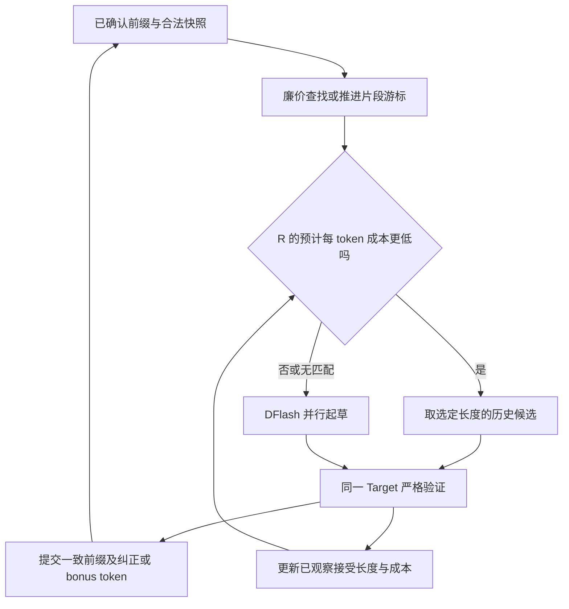

# MemoryDraft 新方向：验证反馈驱动的历史片段复用

2026-10-17 制定，2026-10-18 执行更新：**基础R/DFlash融合、A接入与B开发已完成，见 REUSE_PILOT_RESULTS；另完成4个新schema项目的小规模独立确认，见 REUSE_CONFIRMATION_RESULTS，Global为DFlash的1.240×。接受长度模型未实现；独立项目规模按单独协议收敛，未执行下文最大规模。** 下文为研究计划及用户修订，不将规划参数当作已运行结果。

用户要求详细规划新方向。本文承接 H 与 DFlash 的已完成实验。所有拟议长度、样本规模和门槛须在正式运行前冻结；它们不是已测收益。

**用户后续修订（2026-10-17，优先于此前方案）：目标是在明确的适用场景中表现优秀，不要求打败全部基线或在所有工作负载上获胜。允许复用成熟架构，围绕场景形成有依据的差异和可测贡献。先找适用场景、实现最小有效组合，再决定是否需要复杂反馈模型。**

## 1. 决策与候选贡献

暂停继续优化当前“检索文本，再让独立小模型逐 token 起草”的 H 主线，保留实现、消融和负结果。新主线是在成熟 Draft 上直接复用合法历史接续，减少模型起草成本。这是研究方向修订，不表示旧版 H 成功目标已经实现。

已有依据见 [H_TRAINING_RESULTS](H_TRAINING_RESULTS.md)：未训练 H 有正信号；训练后 H−D_format 接受长度差为 −0.009、区间跨零，D/H 时间比为 1.009，RHD off/on 为 0.991，区间均跨 1。训练后 D_format 已达到 3.749/4，当前模板任务接近候选长度上限，不能推广为所有 H 都无效。

采用已实测的 Qwen3-8B + 官方 DFlash-b16。它的 2.213× AR 来自旧 12 请求，不能算作新方法收益，也不能直接与新 H 测试集比较。

核心问题是：**在当前已确认前缀上，一段历史预计还能连续命中多少 token？复用它是否比 DFlash 更省时？**

候选算法贡献：用严格验证反馈估计上下文相关的连续接受长度分布，再结合验证、检索和缓存回切成本，决定来源及复用长度。它是可选的后续增强，不是开始研究的前置条件。首先复用成熟的后缀检索、局部重匹配与 DFlash，测量它们在选定场景中的行为；已有简单策略足够时，不为形式上的区别增加模型或模块。

贡献也可以是特定场景的系统设计、有效适用边界与成本取舍。例如在同项目连续修订中，结合合法记忆快照、局部重匹配与低成本缓存恢复。须用实验说明这些取舍的作用，标注继承的组件及来源；不要求所有组件原创，也不将简单组合自动视为已证实的新算法。

### 1.1 优先场景与发现规则

第一优先级为**同一项目多轮局部修订，应用本来就需要返回较长的完整产物，改动集中而周围结构稳定**。代码、配置和文档是候选载体；这只是机制上最有希望的场景，尚无新实验支持其收益。

| 场景 | 候选优势 | 首先排查的失败边界 |
|---|---|---|
| P1：同项目完整文件/文档的局部修订 | 可能有长的连续稳定片段，修改附近用 DFlash，随后恢复 R | 改动分散、整体重写、格式大幅改变 |
| P2：同一产物的多轮反馈修订 | 过去输出和本轮已验证位置可提供定位信息，索引维护可跨请求摊销 | 版本冲突、频繁插入/重排、缓存补齐成本 |
| P3：已有模板的配置/结构化文档生成 | 固定结构可能复用；需要检查动态字段是否打断连续命中 | 输出短、字段值密集变化、仅语义相似而 token 不同 |
| 边界组：新话题、短答案、只输出 diff 的编辑任务 | 用于说明何时回退 DFlash | 不作为必须获胜的主场景 |

P1/P2 可以重叠；探索时单独标记“首次修改/连续修改”，不将同一项目当作多个独立样本。P3 排在后面，因为相同模板未必产生足够长的连续可接受接续。

场景发现只用开发数据，之后冻结适用条件，在新的项目上确认。条件优先来自请求时已知的信息：任务类型、应用要求的完整输出或 diff 模式、历史规模、修订轮数和明确的修改目标。实际输出的编辑比例、稳定片段长度等只能作离线机制分析，不能供当前路由或事后测试筛选使用。

同等修改量下，对比集中改动与分散改动；同时看输出长度、连续可复用区间、重匹配频率和维护成本。目标是得到可解释的适用边界，而非挑出个别最快的例子。应用本来要求 diff 的请求保持 diff，不人为改成完整重写制造优势。

阶段 B 从 P1/P2/P3 及边界组各取 3 个开发项目，共 12 个，先选定一个主场景。只有开发证据支持才增加第二场景；无需同时在四类上获胜。

## 2. 与现有论文的关系

| 工作 | 已有机制 | 本项目的比较边界 |
|---|---|---|
| [REST](https://aclanthology.org/2024.naacl-long.88/) | 检索已有文本作为候选 | 直接复制接续已有依据 |
| [SAM-Decoding](https://arxiv.org/abs/2411.10666) | 后缀匹配、静态/动态资源、与模型 Draft 混合 | 匹配后选择模型 Draft 不是新贡献 |
| [SuffixDecoding](https://arxiv.org/html/2411.04975v3) | 当前/过去序列的后缀树、动态长度、与 EAGLE-3 混合 | 优先考虑的相关对照与可复用架构，按最终场景确定具体比较路径 |
| [EfficientEdit](https://arxiv.org/html/2506.02780v1) | 复用原代码、生成修改、重新匹配 | 复制—修改—再复制已有先例；其生成阶段放宽验证，不照搬完整质量/速度结论 |
| [ReSpec](https://arxiv.org/html/2511.01282v1) | 触发检索、位置接受率 EMA、候选筛选 | 反馈打分已存在；检索部分放宽验证，严格版本需另外标注 |
| [DReSD](https://arxiv.org/html/2502.15572v1) | 上下文化 token 表征的稠密接续检索 | 初版不增加稠密检索，先证明可复用接续有足够机会 |
| [DFlash](https://arxiv.org/abs/2602.06036) | Target 特征条件化的并行候选块 | 复用成熟权重和前向，不将底座收益归于记忆 |
| [ReTrace](https://arxiv.org/abs/2608.29748) | 在 DFlash 上条件化复用被拒绝轨迹 | “把旧候选塞回 DFlash”也已有研究，本阶段不增加该支线 |

以上为本次文献核查，不声称已复现所有方法或完成全面新颖性认定。使用任何新增上游代码前核查具体 commit、许可证和接口。

## 3. 运行示例

以下是机制示意，不是实测输出。合法历史有旧代码：

```python
def select_items(items):
    result = []
    for item in items:
        if item.score > 10:
            result.append(item.name)
    return result
```

当前请求要求阈值改为 20，其他行为保持。所有方法的 Target 输入相同；历史只是候选来源。

1. 用已确认的输出 token 定位旧片段。没有可靠锚点时走 DFlash。
2. 若估计复用更便宜，直接取一段历史候选，由 Target 并行验证。
3. 假设 Target 选择同样结构，前面一致部分被接受；遇到 `10` 和当前选择不一致，停止接受并提交 Target 的纠正 token。
4. 记录本次上下文中的局部失败位置；后续尚未在正确前缀下验证的旧 token 仍为未知。
5. DFlash 处理修改附近的内容；新前缀与旧记录后面的稳定片段重新形成精确锚点时，恢复 R。
6. 如果 Target 选择另一种实现，就持续走 DFlash，不强迫旧结构。

实际操作使用 token IDs，不能假设数字、单词或一行代码恰好是一个 token。



## 4. 算法细节

### 4.1 合法记忆与接续检索

复用 `MemoryStore.snapshot(user_id, before_order)`。当前只暴露当时 active 的最新事件，不为了版本研究取回 superseded/deleted 记录。多个历史文档仅在各自合法可用时作为不同来源；内容哈希变化后使位置反馈失效。

继续使用 `SuffixArrayIndex` 和 pydivsufsort，增加有界候选元数据：记录 ID、内容哈希、token 位置、匹配长度、歧义程度。保留原单一候选接口供旧实验使用。重复匹配可能产生大量位置枚举，需固定扫描预算和候选上限，报告截断行为。

R 查找的是输出前缀后的 token 接续，不在每轮做 embedding/RAG 检索。项目元数据可作为廉价分片条件，但要和全合法历史索引比较，不强制用语义 top-k 限制 R。

归因实验的候选资源分开控制：当前 prompt 与已确认输出；再额外加入合法过去回答。所有检索基线获得同样资源。prompt 文本只作为待验证候选，不作为额外指令；过去记录初版沿用定稿 assistant 内容。

### 4.2 连续复用与局部失败

本请求维护 `snapshot + 内容哈希 + token 位置 + 已匹配上下文` 游标。连续接受后先推进游标，减少全局查询。

拒绝只抑制当前上下文中的失败接续，不封禁整条记录。DFlash 生成并验证新内容后，用新的已确认前缀查找；优先有界的邻近窗口，再按预算查全局索引。歧义高时缩短或回退。

游标只是定位手段，不能跳过输出或跳过验证。不同前缀下的旧 KV 不直接复用。该状态机已有编辑加速先例，必须单独消融，不能充当未验证的新颖性。

### 4.3 估计连续接受长度

令 A 是候选从头连续被接受的 token 数，L 是提议长度，x 为决策前可见特征：

`s_j(x) = P(A >= j | x)`

特征包括匹配长度、候选歧义、记录类型/版本、当前连续复用长度、近期严格反馈、距局部失败位置的距离、上下文长度及 Draft 缓存落后量。初版用少量离散特征与深度桶构造平滑概率表；必要时再比较小型条件模型，不增加额外大模型调用。

也可估计条件成功率 `q_j = P(A >= j | A >= j-1, x)`，再用 `s_j = q_1 * ... * q_j`。这是条件概率链式分解，不是假设 token 独立。

`E[min(A,L) | x] = sum(s_j(x), j=1..L)`

通常还会提交一个纠正或 bonus token，稳态预计推进量约为 `1 + sum(s_j)`；EOS 和剩余预算按真实规则截断。

反馈处理是本假设的重点：

- 提议 16 个，前 7 个接受、第 8 个拒绝：得到 7 个连续成功和第 8 个失败。之后的 logits 依赖错误候选前缀，不能作为纠正后前缀的标签。
- 16 个全接受：只知道 A 至少为 16，不能把第 17 个记为失败。这是右删失观察。
- EOS/预算终止不等于后续失败。
- 未选择的另一分支没有在线反事实标签，不能用事后 AR 答案免费打分。

单一接受率分数会混合长度与失效位置，分布估计可能更适合成本选择；只有简单规则在目标场景中出现可定位的问题时才实现本增强。若主张分布估计有效，就与相应 EMA/长度打分在相同预算下做消融；不要求先复现所有文献才启动场景验证。

权重、特征、平滑系数和门控超参数在开发集固定。测试只允许预先规定的因果状态更新。默认项目间不共享反馈；跨请求反馈仅在明确的时间序列回放中单独评估。每个方法、每次重复重置到相同起点。

### 4.4 成本门控与长度

拟议指标：

`cost_R(L) = (增量查找 + 取候选 + Target验证(L) + 状态维护 + 预留回切成本) / 预计推进量`

`cost_D = (DFlash起草 + Target验证 + 缓存追赶及维护) / 预计推进量`

R 长度初步考虑 `{4,8,16,32,64}`，在开发集冻结实际范围。DFlash 保持官方 block_size=16：它包含一个已知 anchor 和 15 个待提议位置。R 长度定义为 anchor 后提议数，另外记录实际验证输入长度。

只在保守估计仍支持 R 更便宜时启用。选定主场景内至少降低 5% 延迟可作初步工程参考，正式门槛依据开发阶段测量与实际应用需求在测试前固定；不要求混合所有场景后仍达到该比例，也不自动用作每轮阈值。成本模型是局部近似，不宣称全局最优。

先用廉价元数据/游标判断是否查询；查询发生后是沉没成本，比较剩余动作时正确处理，同时在端到端延迟中完整计入。没有历史的请求不应每轮扫描索引。

开发集标定验证长度、上下文长度和缓存状态的成本。在线只更新实际已选动作，不先运行 R 和 DFlash 再选择。回切成本可在决策时预留，实际计时仅在发生时记一次。离线 oracle 仅作诊断，不能当作部署性能。

## 5. DFlash 接入约束

已阅读项目锁定的 `models/dflash-audit/dflash.py`。`spec_generate` 将起草和验证写在同一循环中，没有现成的项目路由接口。需要薄适配，先证明禁用 R 后与官方版本一致。

关键状态约束：

1. 区分已确认且已写入 Target KV 的 token，以及已提交但尚未前向处理的纠正/bonus anchor。
2. R 验证同样保留 DFlash 所需的 Target 层特征；只保留正确一致前缀的特征，拒绝后的丢弃。
3. 连续 R 期间 Draft KV 落后，累计它自上次消费后遗漏的全部有效特征；下一次 DFlash 前向按正确位置补齐，不能只给最后一次 R 的特征。
4. 累计特征设显存上限，触发同步/回退时计入全部开销；不能免费重跑 Target 或静默截断上下文。
5. 测试 R→R、R→DFlash、DFlash→R、首次拒绝、全接受、EOS 和剩余长度边界。

复用模型、attention 和验证语义。若摘出 MIT 上游循环做小范围适配，保留许可、commit 和差异说明。现有 Transformers 4.52.2 后端不能假定兼容 DFlash 的 4.57.3 环境。

## 6. 分阶段实验

| 阶段 | 问题与规模 | 通过条件 |
|---|---|---|
| A：正确性 | 8 个覆盖边界的短请求、强制切换、原生/适配后 R 关闭对照 | 全部与 AR token 一致，解释并消除显著适配开销 |
| B：场景发现 | 12 个开发项目，按 1.1 节分组；同前缀 R/DFlash 接受长度及成本剖面 | 至少一个可明确界定的场景有覆盖查找和回切成本的机会；该场景通过即可继续 |
| C：独立评估 | 项目预算最多 train/dev/test=24/12/24，每项目 3 次顺序修订；测试每方法 3 次交错计时 | 冻结主场景，在新项目上确认净收益、设计贡献和适用边界 |

阶段 B 项目属于开发集，不再进入测试。阶段 C 上限为 60 项目、180 个当前修订请求，测试最多 72 请求，以项目作统计单位；简单规则无需训练时不为凑规模生成训练集。独立测试以选定主场景为主，边界组单列，其数量与比例在运行前冻结。B 没找到合适场景就修订假设，不扩大无差别评测；先完成主要对照，再做与实际改动对应的消融。

数据尚未构建。来源候选为公开代码编辑数据、合法公开版本/文档记录，以及单独报告的合成机制集。开发场景组按 1.1 节构造；插入删除/重排、同名片段歧义和低重复用来说明边界，不要求各类都加速。CanItEdit/CodeIF-Bench 仅为待审查来源，尚未核验数据许可或完成下载。

按完整项目、仓库和模板家族分割并去重，保留未见家族测试。不能将同一项目修订随机拆分，也不能看 Target 速度或新方法收益后挑任务。旧 H 八项目及 DFlash 十二请求只作回归。

每轮快照先冻结；只使用该轮之前完成的记录。当前参考答案用于离线评分，本轮结束后才能按预定协议成为下一轮历史。方法间初始历史相同，路由反馈独立；每次重复恢复初始状态。

主实验对照“当前上下文”和“当前上下文+过去回答”。另外用相同 token 预算比较合法用户历史、通用公共文本和独立合成干扰历史，不借用其他真实用户私有记录。如果收益全来自当前 prompt，只能称为编辑/重复文本加速。

输出预算按任务预先固定 512 或 1024 token，并保留短输出负对照；报告截断比例。所有方法共享 Target prompt、模型、tokenizer、精度、attention、停止规则和预算。

## 7. 基线、消融与指标

核心对照缩减为：AR（正确性与参考）、原生 DFlash（成熟加速底座）、一个最相关的历史/编辑复用基线、我们的场景方案。场景确定后在 SuffixDecoding 式混合与编辑复用路径中选取最贴近的一项，不以逐一击败所有方法为完成条件。适配后关闭 R 是必要接入检查；纯 R、匹配长度规则和接受率 EMA 按具体假设选择作消融，不全部升级为必跑完整基线。可读取的候选资源保持公平。

允许直接借鉴 SuffixDecoding、SAM-Decoding 或编辑复用架构中许可兼容的组件，在我们的任务、记忆和后端约束下做必要适配。相关基线的官方路径若不兼容，明确说明限制、选择可比实现；若做机制适配，标为适配版本，不当作官方完整结果。放宽验证的论文方法不能直接并入严格 greedy 速度表。树结构、所有检索器及全部论文复现都不是前置要求。

按实际实现选取的消融清单：

1. 长度分布估计替换成接受率 EMA。
2. 成本选择替换成匹配长度阈值。
3. 移除本请求局部失败反馈，只保留开发先验。
4. 移除游标/邻近窗口，每轮完整查找。
5. 移除过去历史，只用当前上下文。

主指标是选定场景内的同步墙钟端到端延迟，报告 DFlash/新方法和选定相关基线/新方法。计入快照、在线索引增量、检索、路由、prefill、所有模型前向、追赶、解码与反馈更新。冷索引/热索引分开；索引维护计入整个请求序列，不能以预建名义消失。

辅助指标：TTFT、请求 p50/p95（注明样本限制）、每次验证推进量、R 复用 token、DFlash 前向次数、切换成本、长度预测校准、CPU/GPU 内存、无重复组损失。GPU 分阶段计时只作诊断。

主结果在预先冻结的适用场景内汇总，以项目做配对 bootstrap；重复、token、前缀不是独立样本。场景外结果单列；可报告指定部署混合比例的附加结果，不用混合总榜替代目标场景结论。保留逐项目结果，不根据测试表现重新定义“适用场景”或反向调门控。

拟议继续投入标准：

- 全部逐 token 与固定 AR 一致；首个差异保存并停止。
- 在预先确定的主场景内，相对成熟底座取得有实际意义且可重复的净收益；至少 5% 可作开发阶段初步参考，并用项目配对区间评估不确定性。无需在所有场景获胜。场景外退化和关闭/回退策略如实报告，取消此前全局低重复退化不超过 2% 的硬门槛。
- 与一个最相关的公平基线比较，说明具体优势与代价。优势可以是在目标子场景中的速度，或在接近速度下显著减少内存、维护或冷启动成本；采用哪项主张和指标必须在确认测试前固定。无需击败所有基线；若所有被主张的优势都与基线相同，也不凭架构名称不同宣称新增贡献。
- 若声称长期记忆有效，应证明过去历史在当前上下文之外的独立增益；若实际只适合编辑场景，按该场景交付和表述，不据此否定系统的应用价值。
- 狭窄场景可以成立，但需在该场景的新项目上复现，公开不适用边界。只有人为挑选的少数例子有效、或该场景连理想化诊断都无净空间时，停止相应分支；其他场景可以继续。

硬件先使用 A6000 单 GPU、FP32/eager 正确性参考。3090 用于 CPU 分析和小模型检查，不假设 24GB 能容纳 FP32 8B+DFlash。其他精度、生产后端、并发和采样属于后续独立验证；当前 greedy 结果不能直接当作采样保证。

## 8. 现有项目落点与结果解释

| 已有路径 | 拟议改动，尚未实施 |
|---|---|
| `memorydraft/memory/store.py` | 尽量保持快照语义，索引/反馈按内容变化失效 |
| `memorydraft/retrieval/suffix.py` | 有界位置候选、游标与查询预算；保留旧入口 |
| `memorydraft/routing/policy.py` | 保留旧 RHD 行为，新反馈/成本策略隔离实现 |
| `scripts/run_dflash_baseline.py` | 保留独立官方基线，新路由不混入旧结果 |
| `models/dflash-audit/dflash.py` | 许可明确的最小循环适配，先验证 R 关闭一致性 |
| `memorydraft/evaluation/`、`tests/` | 增加切换、删失反馈、时间隔离、空历史检查 |

具体新脚本和 CLI 在实现阶段核实并冻结，本文不虚构已存在命令。本轮只完成文献/代码核查与规划，没有新推理实现、GPU 作业或实验结果。

若 R+DFlash 在选定场景有用而简单混合已足够，就采用简单方案，报告场景适配与工程收益；反馈模型不作为强制交付。若只有游标有效，归因于检索工程；只有资源变多有效，则归因于候选资源。若某类场景强 Draft 太便宜、历史覆盖低或回切成本过高，记录该类边界，不要求其他有效场景一起停止。

H 仅在新任务上出现机制证据时重启：R 弱匹配且强 Draft 出错的位置，H 有稳定独立接受增量，并有覆盖完整成本的空间。增加历史相关度、训练轮数或检索复杂度本身不构成重启理由。
